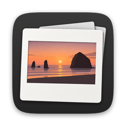

<p align="center">
  
</p>

<h1 align="center">AnotherPhotoFrame</h1>

<p align="center"><b>Create once. Export anywhere.</b></p>

<p align="center">
  <a href="https://github.com/Jeremy233/another_photo_frame/releases"></a>
  <a href="https://github.com/Jeremy233/another_photo_frame/actions/workflows/ci.yml"></a>
  <a href="LICENSE"></a>
</p>

<p align="center"><a href="#中文">中文</a> · <a href="#english">English</a></p>

---

## 中文

AnotherPhotoFrame 是一个免费、开源、完全在本地运行的 macOS 摄影发布工具。

它只处理已经在 Lightroom、Photoshop、Capture One 等软件里修完并导出的成片，把「修图完成 → 发到社交平台」这一步做成可重复的预设：加白边、按平台尺寸排版、把超宽全景切成能在轮播里无缝滑动的多张图，再加上水印和拍摄参数。一次设置，批量导出到 Instagram、小红书、抖音。它不是修图软件，不联网，也不上传你的照片。

### 功能

- **完整嵌入，不裁切**：照片按比例完整放进平台画布，保证最小留白，背景色可调。
- **全景无缝切片**：超宽照片自动生成一张封面加多张切片，在轮播里左右滑动时接缝处像素连续。
- **摄影级色彩管理**：保留并正确转换 ICC 色彩配置；支持 HDR 照片（增益图 JPEG、HDR TIFF），HDR 源图默认导出 HDR，同时为不支持 HDR 的设备保留 SDR 版本。
- **水印与 EXIF 图层**：签名、水印、相机图标、拍摄参数文字；相机图标可以按照片的相机品牌型号自动选择。
- **预设可分享**：预设导出成 `.photoframe` 文件发给别人，但不会带上你的签名、Logo 等私人素材。
- **批量导出**：一次把多张照片导出到多个平台，显示真实进度，可以暂停、取消、重试；导出过程不会留下半成品，也绝不覆盖原图。
- **命令行与 AI**：界面能做的事都能用命令行 `photoframe` 完成，也可以作为本地 MCP 服务器给 AI 助手调用。

### 系统要求

macOS 26 或更高版本，Apple Silicon（M 系列芯片）。

### 安装

1. 在 [Releases](https://github.com/Jeremy233/another_photo_frame/releases) 页面下载最新的 `AnotherPhotoFrame-<版本>-macOS.zip`。
2. 解压，把 `AnotherPhotoFrame.app` 拖到「应用程序」文件夹。
3. 第一次打开：当前版本**没有签名**，macOS 会提示无法验证开发者。打开「系统设置 → 隐私与安全性」，在下方找到 AnotherPhotoFrame，点「仍要打开」。也可以在终端运行：

   ```bash
   xattr -dr com.apple.quarantine /Applications/AnotherPhotoFrame.app
   ```

### 快速上手

1. **加入照片**：把 JPEG、PNG 或 TIFF 拖进窗口中间，或点底栏的「＋」。
2. **选预设**：从左栏「预设」里把一个预设（比如「Instagram Panorama」）拖到照片上，就为这张照片创建了一个导出任务。一张照片可以加多个预设。
3. **调整**：选中任务，在右栏的「画布 / 全景 / 图层 / 输出」里修改尺寸、留白、背景色、切片张数、水印、输出格式等。修改只影响这个任务；点「存储为预设」可以保存成你自己的预设。
4. **预览**：中间上方是成品预览，可以切换封面、每张切片和全景长卷，切换「成品 / 原图」和 SDR / HDR。
5. **导出**：在底栏选择导出位置（默认 `~/Pictures/Social Exports`），点「开始批处理」。进度在「活跃」里，完成后在「已完成」里可以在 Finder 中显示。

导出的文件按平台和作品整理：

```text
Social Exports/
└── Instagram/
    └── 照片名_Panorama/
        ├── 00_Cover.jpg
        ├── 01_Slide.jpg
        └── 02_Slide.jpg
```

右栏的「警告」会提示需要注意的地方，比如照片不够宽只需要两张切片、作品目录已经存在（会自动另存为 `_v2`，也可以选择覆盖）。

### 内置预设

| 平台 | 单图 | 全景 |
|---|---|---|
| Instagram | 1080 × 1440 | 封面 + 切片，每张 1080 × 1440 |
| 小红书 | 1080 × 1080 | 封面 + 切片，每张 1080 × 1080 |
| 抖音 | 1080 × 1920 | 封面 + 切片，每张 1080 × 1920 |

内置预设只读，可以「复制后编辑」；也可以导入别人分享的 `.photoframe` 预设。

### 命令行与 AI 助手

命令行工具 `photoframe` 和应用共用同一套处理流程，适合脚本和自动化：

```bash
photoframe export photo.tif --preset instagram-panorama --preset xhs-panorama --output ~/Pictures/Social\ Exports
photoframe preset list
```

它也可以作为本地 MCP 服务器（`photoframe mcp serve`）让 Claude 等 AI 助手调用，只能访问你明确允许的目录。详见 [命令行工具](docs/usage/CLI.md) 和 [MCP 服务器](docs/usage/MCP.md)。命令行工具在 [Releases](https://github.com/Jeremy233/another_photo_frame/releases) 里单独提供（`photoframe-<版本>-macOS.zip`，解压后保持 `photoframe` 和旁边的 `.bundle` 在同一个文件夹），也可以从源码构建，见 [开发说明](docs/development/README.md)。

### 隐私

所有处理都在你的 Mac 上完成，不联网、不上传。导出时默认去掉拍摄参数和 GPS 位置，需要时可以在「输出 → 元数据」里分别打开。

### 文档

- [文档索引](docs/README.md)
- [开发说明与开发状态](docs/development/README.md)
- [产品与技术规范](docs/design/PhotoFrame_V1_Specification.md)

### 参与贡献

欢迎提交代码和预设，**不接受任何素材**（Logo、线稿、字体、图片等）。详见 [CONTRIBUTING.md](docs/CONTRIBUTING.md)。安全问题请按 [SECURITY.md](docs/SECURITY.md) 私下报告。

### 素材与版权

AnotherPhotoFrame 不内置任何相机品牌的 Logo 或线稿。你导入的照片、Logo、字体等素材的版权由你自己负责。

### 支持项目

AnotherPhotoFrame 免费使用。如果它对你有帮助，欢迎自愿打赏：

- <!-- TODO: 打赏渠道 1 -->（待补充）
- <!-- TODO: 打赏渠道 2 -->（待补充）

打赏完全自愿，不会解锁任何额外功能。

### 许可证

[Apache License 2.0](LICENSE)。Copyright 2026 Jeremy233。

---

## English

AnotherPhotoFrame is a free, open-source macOS publishing tool for photographers that runs entirely on your Mac.

It works on finished photos you have already edited and exported from Lightroom, Photoshop, Capture One and similar apps, and turns the "edit done → post to social media" step into repeatable presets: add margins, lay the photo out at each platform's size, cut ultra-wide panoramas into slides that scroll seamlessly in a carousel, and add watermarks and shooting info. Set it up once, then batch-export for Instagram, Xiaohongshu (RedNote) and Douyin. It is not a photo editor, it works offline, and it never uploads your photos.

### Features

- **Full fit, never cropped**: the whole photo is placed in the platform canvas with a guaranteed minimum margin and an adjustable background color.
- **Seamless panorama slides**: ultra-wide photos become a cover plus slides whose pixels line up across every seam when swiped in a carousel.
- **Photographic color management**: ICC profiles are preserved and converted correctly. HDR photos (gain-map JPEG, HDR TIFF) are supported; HDR sources export as HDR by default, with an SDR version kept for devices without HDR.
- **Watermark and EXIF layers**: signature, watermark, camera badge and shooting-info text; the camera badge can be picked automatically from the photo's camera make and model.
- **Shareable presets**: export a preset as a `.photoframe` file to share it, without your private signature or logo assets.
- **Batch export**: export many photos to many platforms at once with real progress, pause, cancel and retry. Exports never leave half-written files and never overwrite your originals.
- **Command line and AI**: everything the app does is also available from the `photoframe` command, which can also run as a local MCP server for AI assistants.

### Requirements

macOS 26 or later on Apple Silicon (M-series).

### Install

1. Download the latest `AnotherPhotoFrame-<version>-macOS.zip` from [Releases](https://github.com/Jeremy233/another_photo_frame/releases).
2. Unzip it and drag `AnotherPhotoFrame.app` into Applications.
3. First launch: this version is **not signed**, so macOS says it cannot verify the developer. Open System Settings → Privacy & Security, find AnotherPhotoFrame near the bottom and click "Open Anyway". Or run:

   ```bash
   xattr -dr com.apple.quarantine /Applications/AnotherPhotoFrame.app
   ```

### Quick start

1. **Add photos**: drag JPEG, PNG or TIFF files into the middle of the window, or click "＋" in the bottom bar.
2. **Pick presets**: drag a preset (for example "Instagram Panorama") from the Presets list on the left onto a photo to create an export job. A photo can have several presets.
3. **Adjust**: select a job and change size, margins, background, slide count, watermarks or output format in the Canvas / Panorama / Layers / Output tabs on the right. Changes apply to that job only; "Save as Preset" keeps them as your own preset.
4. **Preview**: the top of the middle column shows the result. Switch between the cover, each slide and the full panorama strip, between finished and original, and between SDR and HDR.
5. **Export**: choose a location in the bottom bar (default `~/Pictures/Social Exports`) and click Start Batch. Progress shows under Active; finished jobs under Completed can be revealed in Finder.

Exports are organized by platform and work:

```text
Social Exports/
└── Instagram/
    └── PhotoName_Panorama/
        ├── 00_Cover.jpg
        ├── 01_Slide.jpg
        └── 02_Slide.jpg
```

The Warnings section on the right points out anything to check, such as a photo that only needs two slides, or a folder that already exists (it is saved as `_v2`, or you can choose to overwrite).

### Built-in presets

| Platform | Single photo | Panorama |
|---|---|---|
| Instagram | 1080 × 1440 | cover + slides, 1080 × 1440 each |
| Xiaohongshu | 1080 × 1080 | cover + slides, 1080 × 1080 each |
| Douyin | 1080 × 1920 | cover + slides, 1080 × 1920 each |

Built-in presets are read-only; duplicate one to edit it. You can also import `.photoframe` presets shared by others.

### Command line and AI assistants

The `photoframe` command uses the same processing as the app and suits scripts and automation:

```bash
photoframe export photo.tif --preset instagram-panorama --preset xhs-panorama --output ~/Pictures/Social\ Exports
photoframe preset list
```

It can also run as a local MCP server (`photoframe mcp serve`) for Claude and other AI assistants, limited to folders you explicitly allow. See the [command-line guide](docs/usage/CLI.md) and [MCP server guide](docs/usage/MCP.md) (in Chinese). The command-line tool is available separately on [Releases](https://github.com/Jeremy233/another_photo_frame/releases) (`photoframe-<version>-macOS.zip`; keep `photoframe` and the `.bundle` next to it in the same folder), or build it from source; see the [development notes](docs/development/README.md).

### Privacy

Everything runs on your Mac: nothing is uploaded and no network is used. Shooting info and GPS location are removed from exports by default; turn them on separately under Output → Metadata if you want them.

### Documentation

The documents are currently written in Chinese.

- [Documentation index](docs/README.md)
- [Development notes and status](docs/development/README.md)
- [Product and technical specification](docs/design/PhotoFrame_V1_Specification.md)

### Contributing

Code and presets are welcome; **assets of any kind are not accepted** (logos, line art, fonts, images, …). See [CONTRIBUTING.md](docs/CONTRIBUTING.md). Please report security issues privately as described in [SECURITY.md](docs/SECURITY.md).

### Assets and copyright

AnotherPhotoFrame does not bundle any camera brand logos or line art. You are responsible for the rights to any photos, logos, fonts or other assets you import.

### Support the project

AnotherPhotoFrame is free. If it helps you, voluntary donations are welcome:

- <!-- TODO: donation channel 1 -->(to be added)
- <!-- TODO: donation channel 2 -->(to be added)

Donations are entirely optional and unlock nothing.

### License

[Apache License 2.0](LICENSE). Copyright 2026 Jeremy233.
