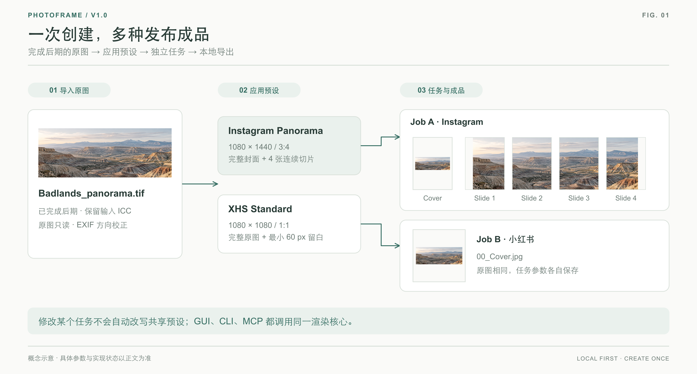
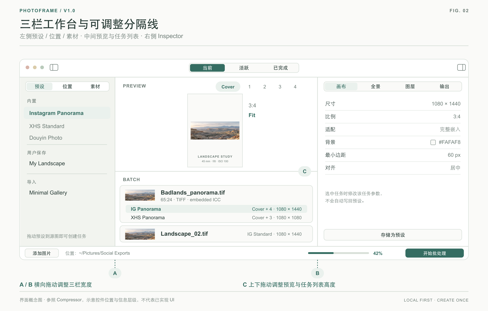
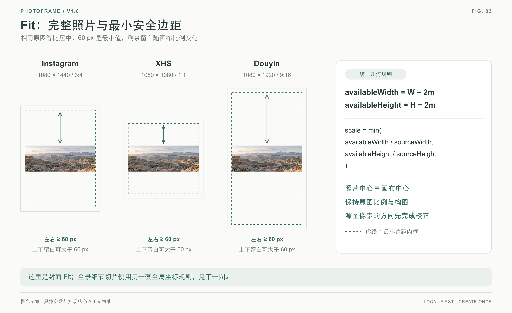
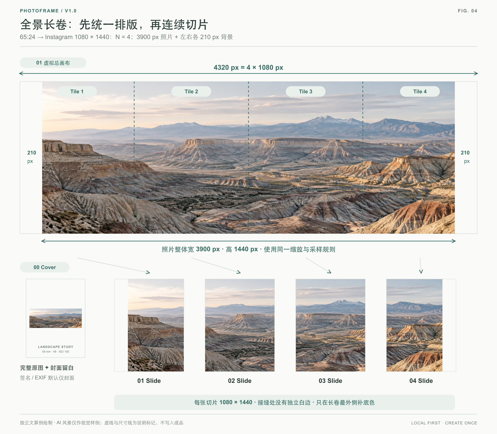
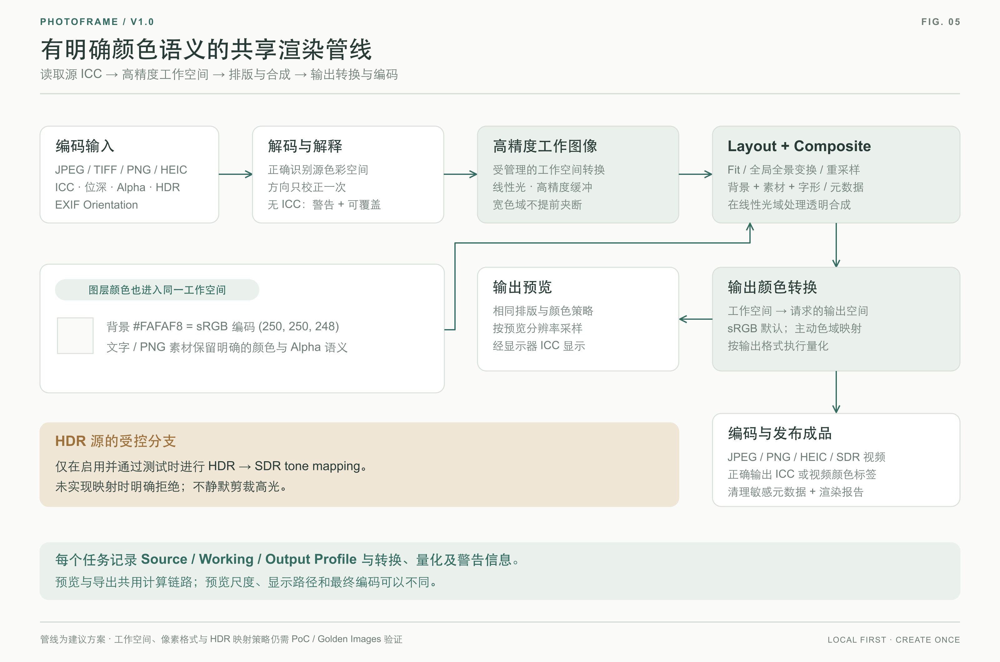
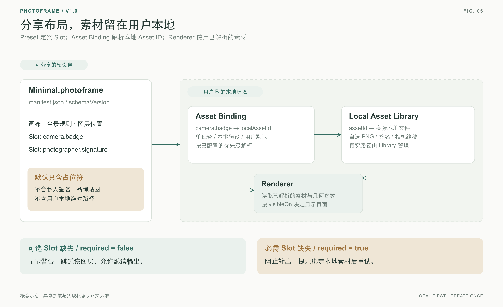
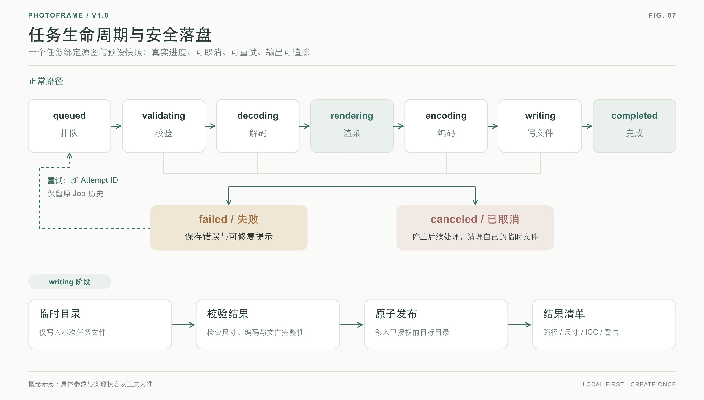
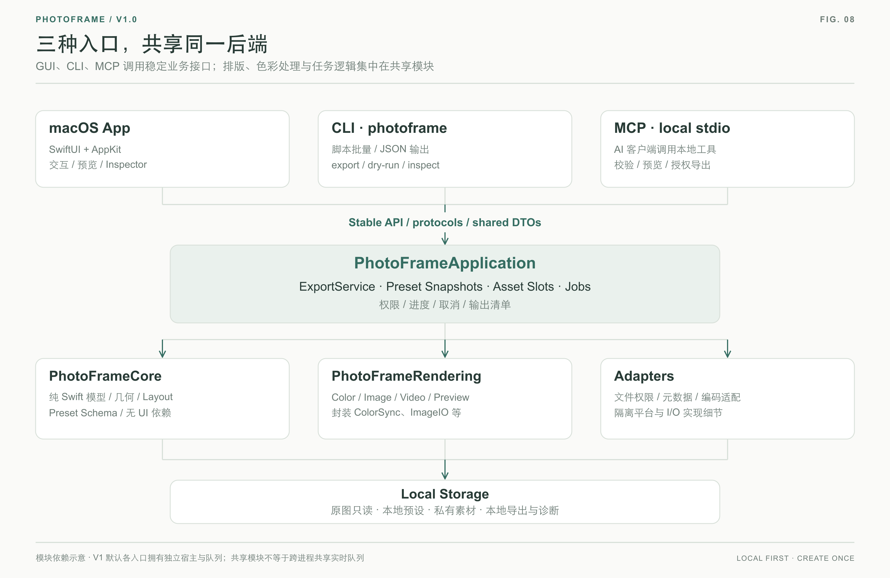

# AnotherPhotoFrame — V1.0 产品与技术规范（Review Draft）

> **状态：供逐条审阅 · Draft 0.1**  
> **基线日期：2026-10-12**  
> **产品定位：** *Open-source Photography Publishing Toolkit for macOS*  
> **口号（暂定）：** *Create once. Export anywhere.*  
> **版本范围：** MVP → Alpha / Beta → V1.0；不包括未来的远程服务器、移动端客户端。  
> **标记约定：** **【已确定】** = 用户明确确认；**【建议】** = 当前技术方案、尚可调整；**【待确认】** = 开发前需拍板；**【V1 不做】** = 刻意排除。  
> **审阅方法：** 可直接在每节后添加 `Review:` 评论，或修改文末《待确认决策清单》。

---

## 目录

1. [产品愿景与原则](#1-产品愿景与原则)
2. [范围与版本边界](#2-范围与版本边界)
3. [典型工作流与用户故事](#3-典型工作流与用户故事)
4. [应用界面与交互规范](#4-应用界面与交互规范)
5. [画布、留白与全景无缝切片](#5-画布留白与全景无缝切片)
6. [摄影级色彩处理管线](#6-摄影级色彩处理管线)
7. [排版图层、水印、相机贴图与元数据](#7-排版图层水印相机贴图与元数据)
8. [预设与素材系统](#8-预设与素材系统)
9. [任务队列与导出](#9-任务队列与导出)
10. [系统架构与模块边界](#10-系统架构与模块边界)
11. [后端 API、CLI 与 MCP](#11-后端-apicli-与-mcp)
12. [性能、可靠性、安全与隐私](#12-性能可靠性安全与隐私)
13. [测试计划与验收标准](#13-测试计划与验收标准)
14. [发布、开源及开发里程碑](#14-发布开源及开发里程碑)
15. [风险与权衡](#15-风险与权衡)
16. [待确认决策清单](#16-待确认决策清单)
17. [V1.0 验收 Checklist](#17-v10-验收-checklist)

---

## 1. 产品愿景与原则

### 1.1 要解决的问题

摄影师通常已经在 Lightroom、Photoshop、Capture One、PixInsight 等软件中完成后期，但发布到不同社交平台时，还需要重复执行：建立不同画布、保留原图、添加统一留白、制作水印／器材信息、超宽幅切片、重命名文件和批量输出。PhotoFrame 只解决这段**「后期完成 → 发布成品」**的流程，不另造一个修图软件。

### 1.2 核心原则

| 原则 | 要求 | 状态 |
|---|---|---|
| macOS First | 优先追求原生 macOS 体验，使用 SwiftUI + AppKit | 【已确定】 |
| 免费、开源 | V1 免费，无订阅、账号或自建云服务依赖 | 【已确定】 |
| Local First | 原图、预设、素材和渲染结果默认仅在本地 | 【已确定】 |
| 前后端分离 | GUI 不包含排版或图像处理实现，调用统一后端服务接口 | 【已确定】 |
| GUI / CLI / MCP 三入口 | 三者共享同一套排版、渲染、预设与任务服务 | 【已确定】 |
| 非破坏式输出 | 不覆盖原始照片、不擅自改变画面比例与构图 | 【已确定】 |
| 色彩准确 | 保留并正确解释源文件色彩信息；预览与导出使用同一计算链路 | 【已确定：目标；具体方案见第 6 节】 |
| 预设可分享 | 排版预设独立于私有素材，可导入、导出、版本迁移 | 【已确定】 |
| 素材由用户掌控 | 预设通过占位符绑定用户本地素材，默认不打包素材 | 【已确定】 |
| 未来可扩展 | 后端可供 iOS/iPadOS、远程接口及社区第三方客户端复用 | 【已确定：架构方向】 |

### 1.3 不追求的目标

- 【V1 不做】RAW 传感器解码与去马赛克、调色、曲线、降噪、HDR 合成、全景拼接（stitching）。输入应是**已经处理好的图像**。
- 【V1 不做】自动直接发布到 Instagram / 小红书 / 抖音；只输出可上传的文件。
- 【V1 不做】统一账户体系、用户登录、PhotoFrame 托管云、在线预设商店。
- 【V1 不做】远程网络服务、Discord/Telegram Bot、手机网页远程渲染、自托管 HTTP API。
- 【V1 不做】Windows 原生版、iOS/iPadOS 原生版、iCloud 同步；仅为其保留架构扩展点。

---

## 2. 范围与版本边界

### 2.1 V1.0 目标功能（**交付范围**）

| ID | 功能 | V1 要求 | 状态 |
|---|---|---|---|
| FR-01 | macOS GUI | Compressor 风格三栏、自适应窗口、自由拖动分隔条 | 【已确定】 |
| FR-02 | 图像输入与预览 | JPG/PNG/TIFF（含 HDR 变体）；HEIC 放到 V2；正确方向、ICC、缩略图 | 【已确定：D-02】 |
| FR-03 | 画布引擎 | 任意目标尺寸、背景颜色、最小边距、Fit/居中；可选比例裁切模式 | 【已确定：D-21】 |
| FR-04 | 全景轮播 | 完整封面 + 无裁切、左右补底色的连续切片 | 【已确定】 |
| FR-05 | 平台预设 | Instagram、XHS、Douyin（用户可修改） | 【已确定】 |
| FR-06 | 排版图层 | 签名、水印、相机贴图、EXIF 信息等可选图层 | 【已确定】 |
| FR-07 | 素材库与 Slots | 本地自选素材、占位符、预设绑定、缺失处理 | 【已确定】 |
| FR-08 | 预设管理 | 创建、复制、编辑、导入、导出、分享、schema 版本 | 【已确定】 |
| FR-09 | 批处理 | 多原图、多预设、队列、进度、取消、重试 | 【已确定】 |
| FR-10 | 图像导出 | JPEG、PNG；V1 不输出 HEIC | 【已确定：D-36】 |
| FR-11 | 视频导出 | V1、V2 不做；V2 考虑 Live Photo，V3 及以后再做视频 | 【V1 不做：D-16】 |
| FR-12 | CLI | 独立可执行文件、可脚本化、JSON 输出 | 【已确定】 |
| FR-13 | MCP | 本地 stdio MCP Server，供 AI 客户端调用 | 【已确定】 |
| FR-14 | 色彩管理 | 输入 ICC、色彩转换、正确合成与输出 ICC、可测试 | 【已确定】 |
| FR-15 | 隐私安全 | 本地数据、路径权限、默认剥离敏感位置元数据 | 【建议】 |

> **范围控制说明：** 表中 V1 指正式稳定版的目标集；并非第一天就同时实现。V1 的 HDR 输出、SVG、安全解析等复杂子项可以在 Alpha/Beta 阶段用能力开关逐项交付，但正式发布前应明确哪些已通过验收。

### 2.2 推荐默认值（用户个人风格，不应硬编码为唯一风格）

| 平台 / 模式 | 画布 | 背景 | 封面最小边距 | 图像策略 |
|---|---:|---|---:|---|
| Instagram Standard / Panorama | 1080 × 1440，3:4 | `#FAFAF8` | 60 px | 完整图等比居中；全景另输出连续切片 |
| 小红书 XHS Standard / Panorama | 1080 × 1080，1:1 | `#FAFAF8` | 60 px | 同上 |
| 抖音 Douyin Standard / Panorama | 1080 × 1920，9:16 | `#FAFAF8` | 60 px | 同上（Panorama 见 D-31） |

- 【已确定：D-32】内置预设命名为 `<平台> Standard` / `<平台> Panorama`，平台名用英文：`Instagram`、`XHS`、`Douyin`，共 6 个（D-31）。

- 【已确定】当前摄影风格为 **Modern Fine Art Landscape Photography**：中性暖白底、照片为主体、装饰克制。
- 【已确定】原图封面**完整嵌入**画布；不是自动裁切填满。比例裁切仅作为用户主动开启的可选模式（D-21）。
- 【已确定】“60 px”是**最小安全边距**，不是强制照片四周始终恰好 60 px。
- 【已确定】全景连续切片内部的接缝**不能**出现每页独立的 60 px 白边；轮播切片使用独立的全景版式规则。
- 【待确认】各平台允许的图片比例、轮播张数、文件大小、压缩策略会变化；需要把限制写在可更新平台配置中，而不是依赖永久固定的常数。上传前用户仍需检查平台实际预览。

---

## 3. 典型工作流与用户故事

### 3.1 普通照片

1. 用户把后期完成的 JPEG/TIFF 拖入 PhotoFrame。
2. 从左侧将 `Instagram Standard` 和 `XHS Standard` 预设拖到同一张源图上。
3. 中间生成两个独立任务；右侧预览 3:4 或 1:1 的完整画面。
4. 可按需修改背景、60 px 边距、文字或相机图标。
5. 执行队列，分别输出成品；原文件不变。

### 3.2 超宽幅照片（关键工作流）

1. 用户导入比例约 65:24、3:1 的完整全景图。
2. 应用 `Instagram Panorama` 或 `XHS Panorama`。
3. 生成**首页完整图**，等比放入背景画布；后续生成多张**横向连续**的放大细节切片。
4. 不裁掉原图任何左右／上下内容；如整体宽度不足，**仅在总长画布左右两端补 `#FAFAF8`**。
5. 切片之间不各自套边框，保证滑动时几何连续。
6. 如开启签名、EXIF 或相机贴图，默认只出现在封面；连续切片不重复叠加。



*图 1 · 发布工作流：同一原图可生成多种平台成品；每个任务保留自己的参数。风景为 AI 生成的示例素材。*

### 3.3 共享预设

A 用户分享 `.photoframe` 文件；B 用户导入后看到画布与图层布局，其中 `camera.badge`、`photographer.signature` 是**占位符**。B 从自己的本地 Asset Library 为占位符选择图片，或保留空白；不依赖 A 的本地路径，也不需要复制 A 的机型线稿。

### 3.4 自动化

- CLI：批量处理文件夹，读取某预设，输出到指定目录，返回 JSON 结果。
- MCP：AI 查询本地可用预设／源图属性，生成预览，经授权再执行导出。
- 【V1 不做】手机通过互联网访问 Mac。未来该能力通过新的 Remote Adapter 实现。

---

## 4. 应用界面与交互规范

### 4.1 三栏 Compressor 布局



*图 2 · 界面概念示意：A / B 调整三栏宽度，C 调整预览与任务列表高度；示意不代表已实现界面。*

```text
┌───────────────────────────────────────────────────────────────────────────────┐
│ ● ● ●  [◧]             当前 | 活跃 | 已完成                             [◨]   │
├──────────────────┬────────────────────────────────┬───────────────────────────┤
│ 预设 | 位置 | 素材│ PREVIEW   [Cover] [1] ... [N]  │ 画布 | 全景 | 图层 | 输出 │
│                  │ ┌────────────────────────────┐ │                           │
│ 内置             │ │       photo preview        │ │ Width / Height / Ratio    │
│ ───────          │ └────────────────────────────┘ │ Fit / Crop                │
│ 用户保存         ├────────────────────────────────┤ Background / Margin       │
│ ───────          │ BATCH                          │ Align                     │
│ 导入             │ Badlands_panorama.tif          │                           │
│                  │   IG Panorama   4320×1440 ⚠    │                           │
│                  │   XHS Panorama  2925×1080      │                           │
│                  │ Aurora.tif                     │                           │
│                  │   IG Standard   1080×1440      │                           │
├──────────────────┴────────────────────────────────┴───────────────────────────┤
│ 添加图片   位置：~/Pictures/Social Exports    ▓▓▓▓░░ 42%          开始批处理 │
└───────────────────────────────────────────────────────────────────────────────┘
```

- 【已确定】整体参照 Compressor。顶栏中间切换「当前 | 活跃 | 已完成」三个界面；左右两端是侧栏开关。
- 【已确定】左侧 = **预设 | 位置 | 素材**三个标签；中间上方 = **预览**，中间下方 = **源图与任务列表**；右侧 = **Inspector**（画布 | 全景 | 图层 | 输出）。
- 【已确定】左、中、右分隔线可自由拖动；中间的预览与任务列表之间也可上下调整。
- 界面细节见《Another Photo Frame UI Design.md》。
- 【建议】双击分隔线恢复默认大小；允许隐藏侧栏，记住每个窗口最后布局；设置最小可用宽高。
- 【建议】双击照片预览打开大图；支持 Fit、100% 与手动缩放。
- 【建议】主控件可键盘操作，支持 VoiceOver。【已确定：D-105】界面固定深色，不做浅色模式。
- 【建议】界面可以先用 SwiftUI，复杂分割视图优先封装 AppKit `NSSplitView`。

### 4.2 右侧 Inspector 结构

```text
画布   Width / Height / Ratio / Fit or Crop / Background / Margin / Align
全景   On / Auto or Manual Tiles / Vertical Margin / Preview Seam
图层   Watermark / Camera Badge / EXIF Text / Visible On / Asset Slot Binding
输出   Format / Quality / SDR or HDR / Metadata / Naming / Location
```

预览区（中间栏上方）可切换 `[Cover] [Slide 1] ... [Slide N]` 与全景长卷视图。

- 点击**源图**时显示原始信息与 EXIF；点击**任务**时显示该任务实际输出参数；点击多个任务时仅显示可批改的共同字段。
- 改动任务参数**不自动回写共享预设**；通过显式 `Save as Preset` 保存。
- 拖动预设至源图或多选源图即可创建导出任务；按钮操作是等价的非拖拽方式。
- 修改任意参数后通过后端渲染**可复现的低分辨率预览**，而不是另写一套 SwiftUI 假预览。

---

## 5. 画布、留白与全景无缝切片

### 5.1 坐标和输入规范

- 原图经过 EXIF Orientation 校正后，定义显示宽高为 `S_w`、`S_h`，长宽比 `R = S_w / S_h`。
- 输出画布为 `W × H`，坐标原点建议定义为**左上**，`x` 向右，`y` 向下；其他底层坐标系统在适配层转换。
- 背景 `#FAFAF8` 解释为 **sRGB 编码十六进制颜色**，而非未经定义的工作色域数值（详见第 6 节）。
- 图片变换保持比例，居中、无裁切；允许未来自定义其他 Anchor。

### 5.2 单页／封面 Fit 模式

最小边距 `m`，允许放置图像的内框：

```text
availableWidth  = W - 2m
availableHeight = H - 2m
scale = min(availableWidth / S_w, availableHeight / S_h)
imageWidth  = S_w × scale
imageHeight = S_h × scale
originX = (W - imageWidth) / 2
originY = (H - imageHeight) / 2
```

**栅格取整【已确定：D-22】——不动照片，只动 padding：**

```text
pixelWidth  = clamp(round(imageWidth),  1, availableWidth)    # .5 进位
pixelHeight = clamp(round(imageHeight), 1, availableHeight)
left = floor((W - pixelWidth)  / 2),  right  = W - pixelWidth  - left
top  = floor((H - pixelHeight) / 2),  bottom = H - pixelHeight - top
```

- 精确尺寸是整数时（如贴住内框的一边）原样使用，照片不做额外缩放；非整数时只取最近的整数。
- 剩余空间全部由留白吸收，两侧可能相差 1 px，多出的 1 px 固定在右／下。
- 因 `pixelWidth ≤ availableWidth`，两侧留白都 ≥ `m`，不会隐性裁切。

不同原图纵横比产生的剩余留白可大于 `m`。



*图 3 · 封面 Fit：照片等比完整嵌入，虚线是最小安全边距内框；说明标记不写入导出文件。*

### 5.3 全景模式：Cover + Seamless Slides

**核心规则【已确定】：**

- Slide 0 = 完整原图嵌入背景画布，执行普通封面 Fit。
- Slide 1…N = 从**同一张连续的全景总画布**中按固定 tile 宽度切出。
- **不裁切、不拉伸**全景；画面不足时只在总画布左右两端补背景色。
- 不给每一张切片单独添加左右边框，否则接缝不连续。
- 全景切片默认**铺满可用高度 `H`**（即不应用封面 60px 的上下边距）；用户可设置一个所有切片共用的上下边距 `v`（默认 0，D-10），此时以 `H - 2v` 代替下文的 `H` 作为渲染高度。
- 图片装饰（相机图标、签名、EXIF）默认只在 Cover 显示。

**默认算法【建议】：** 设 tile 为 `W × H`，全景按高度 `H` 等比缩放：

```text
renderHeight = H
renderWidth  = R × H
N = ceil(renderWidth / W)       # Auto slide count
stripWidth = N × W
padLeft = padRight = (stripWidth - renderWidth) / 2
```

1. 建立一张 `stripWidth × H` 的虚拟总画布，底色一致。
2. 将整张全景按 `renderHeight=H` 等比居中放入该画布。
3. 按全局坐标 `x = kW`，切出 `[kW, (k+1)W)` 区间，`k=0..N-1`。
4. 所有切片引用**相同的全局缩放、平移和颜色渲染参数**。为节省内存，实现时可以直接逐 tile 按全局变换渲染，无须真正分配超大 strip 位图。
5. 用户只能手动指定**大于或等于**自动值的 `N`（D-11）：更大的 `N` 只增加长卷两端的背景；小于自动值视为参数错误，不缩小全景，绝不裁切。
6. 栅格取整同 §5.2（D-22）：照片在长卷中只栅格化一次，`pixelWidth = round(renderWidth)`，`padLeft = floor((stripWidth - pixelWidth) / 2)`，`padRight` 取剩余；各切片按全局像素坐标 `[kW, (k+1)W)` 切开。

**默认数值验算：**

| 源图比例 | 目标 tile | N | 全景图缩放后宽度 | 左右补边 |
|---|---|---:|---:|---:|
| 3:1 | IG 1080×1440 | 4 | 4320px | 0 / 0 |
| 65:24 ≈ 2.7083:1 | IG 1080×1440 | 4 | 3900px | 210 / 210 |
| 3:1 | XHS 1080×1080 | 3 | 3240px | 0 / 0 |
| 65:24 ≈ 2.7083:1 | XHS 1080×1080 | 3 | 2925px | 157.5 / 157.5（栅格化为 157 / 158，D-22） |



*图 4 · 65:24 → IG 数值算例：只有长卷最外侧补背景，内部接缝不加单页白边；虚线、尺寸线及文字仅用于说明。*

**关键边界：**

- `ceil()` 精度：接近整数边界时使用数值容差，避免本应 N=4 却由于浮点误差生成 N=5。
- 半像素偏移：用连续浮点全局坐标和一致采样规则，导出整数像素时明确取样位置。
- 极端全景：如 N 超过目标平台允许的轮播总张数（包括封面），应告警，并让用户改目标尺寸、分段、降低切片高度或更换模式；**不能无提示截掉照片**。
- 竖图、正方图或 `R` 很小：该模式未必有意义；默认禁用/提示，允许手动启用。判定：`R ≤ 1` 提示为竖图／方图；`R > 1` 但渲染宽度不超过 2 张切片宽（`R ≤ 2W / (H − 2v)`，即自动张数 ≤ 2）时也提示。
- 图片边界与接缝：PNG 无损测试须能按位重建输出像素意义上的虚拟长卷；JPEG 因独立编码会有有损差异，验收以接缝几何对齐、容差/视觉一致性为准。

### 5.4 平台轮播约束

【已确定】定义平台能力描述（可更新，不把第三方规则作为不可变真理）：目标比例、最大项数、文件体积限制、图片格式与上传兼容性、HDR 输出格式。随应用附带一份平台配置数据（编译进程序，D-126），可被更新版本覆盖。

| 平台 | 画布 / 切片 | 轮播上限（含封面） | SDR 格式 | HDR |
|---|---|---:|---|---|
| Instagram | 1080 × 1440 | 20 | JPEG；PNG 待用户实测 | gain map JPEG |
| 小红书 | 1080 × 1080 | 18 | JPEG；PNG 待用户实测 | 待用户实测 |
| 抖音 | 1080 × 1920 | 35 | JPEG；PNG 待用户实测 | 待用户实测 |

- 【暂定：D-30】轮播上限为暂定值；各平台是否接受 PNG、单文件大小上限，与小红书、抖音的 HDR 一起由用户实测后写入平台配置。上传平台可能自动重采样或统一轮播画幅；PhotoFrame 只能保证**本地导出文件**的几何连续，发布时仍须以平台实机预览验证。

---

## 6. 摄影级色彩处理管线

> **本节为 V1 高优先级技术规范。**目标是可复现的 **SDR + HDR 摄影发布工作流**（D-05），而非追求“看起来差不多”。涉及 ColorSync、ImageIO、Core Image / Core Graphics 的交界行为须通过带 ICC 的测试图实测确认。

### 6.1 核心不变量

1. **每个像素值都有颜色语义**：所有输入、背景、图层、预览、输出必须知道自身色彩空间。
2. **不重复转换 ICC**：每一步转换都明确输入空间、目标空间与责任组件，避免 ImageIO、Core Image、Core Graphics 隐性二次转换。
3. **预览 ≈ 导出**：Preview 和 Export 共用相同 Layout + Render Engine，仅采样分辨率、位深和输出编码器不同。
4. **所有缩放先解释颜色再处理**：不在错误 gamma 空间中盲目插值，透明边缘正确合成。
5. **宽色域源图不提前粗暴夹断到 sRGB**：尽可能保持高精度内部处理中间结果，只在指定输出阶段做明确映射。
6. **不把源图 ICC 当作输出 ICC 直接复制**：输出 ICC 必须真实对应已经转换的像素。
7. **跨格式、跨来源可追踪**：每个任务记录源色彩空间、缺失配置时的决策、工作空间、输出配置和警告信息。

### 6.2 输入支持与边界

| 输入类别 | V1 目标 | 约束与处理 |
|---|---|---|
| 8-bit JPEG / PNG | 必须 | ICC、EXIF Orientation、透明通道（PNG） |
| 16-bit TIFF | 必须 | 嵌入 ICC、高精度转换、避免 8-bit 中途量化 |
| HEIC / HEIF（含 iPhone HDR） | 【V1 不做，V2】（D-02） | V1 只处理后期软件导出的成片；V2 再支持，需正确识别 SDR/Wide Gamut/HDR gain map |
| 16-bit PNG | 建议 | 验证系统解码管线是否保留预期精度 |
| Adobe RGB / Display P3 / ProPhoto ICC | 必须测试 | 无提示色域失真不可接受 |
| 无 ICC 的图像 | 必须 | 明确默认假设、提示和人工覆盖途径 |
| 带 Alpha 图层的 PNG | 必须 | 不出现黑边、白晕及预乘错误 |
| HDR：gain map JPEG、PQ/HLG PNG、PQ/HLG/float TIFF | **必须**（D-05） | 保留 HDR 动态范围进入工作空间；按输出设置导出 HDR 或经 tone map 输出 SDR，不可简单剪裁/静默降级 |
| 相机 RAW（NEF/CR3/DNG 等） | 【V1 不做】 | 用户先在其他软件显影导出 TIFF/JPEG |

**HDR TIFF 补充【已确定 2026-10-16，依据色彩 PoC】：**

- Lightroom 勾选"最大化兼容性"导出的 HDR TIFF，结构是 SDR 主图加 SubIFD 里的 ISO 21496-1 gain map。Apple ImageIO 读不到其中的 HDR，V1 自己解析 SubIFD 还原 HDR。暂时无法解析时（例如压缩的 TIFF），按 SDR 读入，并提示"HDR 部分未读取"。
- 32 位浮点 TIFF：支持，读入后先转成 `RGBAh` 再交给渲染引擎。

**无 ICC 策略【建议】：** 默认解释为 sRGB，并在右栏 / 日志显示「源图没有 ICC，按 sRGB 解释」（警告 `source.profile_missing`）；用户可针对**源文件或任务**显式选择另一个输入色彩空间。不得把“无 profile”默默标记为准确的 sRGB 摄影数据。扫描照片尤其需要人工检查。

### 6.3 推荐处理管线（具体 API 实现待验证）

```text
[Encoded Source: JPEG / TIFF / PNG / HEIC]
  ↓ (ImageIO: identify file, ICC, EXIF Orientation, alpha, bit depth, HDR flags)
[Decode & interpret source color space]
  ↓ (Normalize orientation ONCE; remember source profile and user override)
[High-precision working image / pixel buffers]
  ↓ (ColorSync / Core Image managed conversion into a defined working space)
[Layout: FIT / scale / pan / virtual panorama coordinates]
  ↓ (Image resampling with deterministic global transform)
[Composite: background + user-owned assets + glyphs / metadata]
  ↓ (linear-light alpha compositing; high precision; avoid early clipping)
[Output color transform: working → requested output profile]
  ↓ (e.g. sRGB IEC 61966-2-1; deliberate gamut mapping & quantization)
[Encoder: JPEG / PNG]   # V1 不输出 HEIC（D-36）、不输出视频（D-16）
  ↓ (Embed CORRECT output ICC and sanitized metadata)
[File + structured rendering report]
```



*图 5 · 建议色彩管线：预览与导出共用排版和颜色策略，输出文件嵌入与实际像素匹配的颜色描述；工作空间见 D-03，HDR→SDR 策略见 §6.7。*

**建议的后端显式类型：**

- `SourceColorDescription`: embedded ICC, source model, bit depth, alpha, HDR transfer, profileOverride, warnings。
- `WorkingColorPolicy`: internal linear-light extended working space, precision and gamut policy。
- `OutputColorPolicy`: destination ICC (`sRGB` V1 default), rendering intent policy, 8/16-bit mode (where supported), metadata policy。
- `RenderDiagnostics`: source/working/output profile IDs, transform steps, clipping/tone-map warnings。

### 6.4 工作色域、位深、混合

**【已确定：D-03】** 工作色彩空间为 **extended linear Rec.2020**（`kCGColorSpaceExtendedLinearITUR_2020`），像素格式为 **`RGBAh`**（半精度浮点，预乘 alpha）。V1 的输出都是 8-bit，RGBAh 的精度足够；以后如果增加 16-bit 输出，可以按任务改用 `RGBAf`。实测依据见[色彩 PoC 报告](../development/color-poc-report.md)。

- 所有中间结果（Core Image 中间缓冲、自建的 CGImage / CGContext、缓存）都必须是 extended 浮点，不得使用 8-bit 或非 extended 的格式；PoC 实测非 extended 的 CG 上下文会截断广色域。
- 输入 16-bit TIFF 后不得在渲染前无理由转换为 8-bit；JPEG 最终量化到 8-bit 是输出格式本身的正常限制。
- 透明图片与水印：内部定义 premultiplied/unpremultiplied alpha 边界，在**线性光域**以明确规则合成，预防发灰、黑边、彩色边缘。
- 缩放：高质量滤波、统一坐标与采样；预览允许不同采样尺度，但不能采用不同的颜色计算规则。
- 文本／矢量图层：先将指定文字颜色、线稿颜色转换到同一工作空间后合成。

### 6.5 背景色与白边的精确定义

默认背景 `#FAFAF8` 含义：**sRGB 编码的 RGB=(250,250,248)**。不是“Display P3 数值 250/255”，也不是线性 RGB=(0.980,0.980,0.973)。

1. 从 Hex 解析为 sRGB 编码颜色。
2. 通过受管理的色彩转换进入工作空间（含 sRGB EOTF / 转移函数处理）。
3. 与照片在同一工作空间内合成。
4. 输出到 sRGB JPEG 时，在可承受的误差范围内恢复预期 `#FAFAF8` 背景。

【建议】以输出无损 PNG 检验背景 RGB 是否精确为 `(250,250,248)`；JPEG 在高压缩和边缘附近可能出现小偏差，**不要用“所有像素逐点完全相等”作为 JPEG 验收条件**。

### 6.6 预览与显示器

- 预览窗口使用系统管理的显示颜色路径，正确处理显示器 ICC 与 SDR 显示目标。
- 不直接将源图当成无色彩空间的 bitmap 丢进 SwiftUI；预览必须来自已定义颜色管理的 Render Engine。
- 对不同 macOS 显示器（sRGB 外屏、P3 MacBook 屏）进行视觉/数值测试；同一输出文件可能在不同物理显示器视觉略异，不能承诺物理观感绝对一致。
- 软件应提供“输出预览”模式，默认以**最终输出色彩空间 sRGB**软打样或等效显示结果，而不是仅显示原始广色域输入。

### 6.7 SDR / HDR 边界

**【已确定：D-05】V1 支持 HDR 输入与输出。**

- 输入：在文件识别阶段检测 gain map、PQ/HLG 转移函数、float 数据等 HDR 指示，标记 `isHDR` 与 headroom，全程以 extended-range 浮点保留高光，不在 `[0,1]` 截断。
- 输出：HDR 是**可选导出项**。平台配置（§5.4）声明该平台支持的 HDR 输出格式（例如带 ISO 21496-1 gain map 的 JPEG，SDR 底图 + gain map，不支持 HDR 的设备自动退回 SDR）；用户选择 HDR 时按平台配置导出对应格式。
- SDR 输出（也用作 HDR 输出里的 SDR 底图）【已确定 2026-10-16，依据色彩 PoC】：
  1. **源文件自带 SDR 版本时直接使用**：gain map JPEG 的底图，以及 Lightroom"最大化兼容性"TIFF 的主图。这是摄影师在后期软件里确认过的 SDR 版本，不再做 tone map。
  2. **源文件没有 SDR 版本时**（PQ / HLG、纯 HDR 浮点 TIFF），用 Core Image `CIToneMapHeadroom` 做 tone map：`sourceHeadroom` 取画面实际峰值（线性 sRGB 分量最大值的 99.95 分位），`targetHeadroom` = 1。不得使用 PQ / HLG 元数据里的默认 headroom（例如 4.93）。所用方法和参数写入渲染报告。
  3. 背景、水印、文字等 SDR 元素不参与 tone map。
  4. 任何情况下都**不能无声地把高亮直接 clip 到白色**。
- gain map JPEG 的 HDR 版本跟随 SDR 底图的颜色解释：底图的解释改写过（坑 20 的曲线改写、输入色彩空间覆盖）时，把文件里的 gain map 套用到改写后的底图，HDR 的暗部、中间调与 SDR 版本一致（D-127）。
- 合成：背景、水印、文字等 SDR 元素在 HDR 输出中按参考白（SDR 白点）放置，不随 headroom 一起变亮。
- 视频：V1 不做视频输出（D-16）。

### 6.8 输出与元数据

| 输出类型 | 色彩/编码默认 | Metadata |
|---|---|---|
| JPEG | sRGB，8-bit，最高质量 Q100（D-06）；可选 HDR gain map | 嵌入正确 ICC；EXIF 默认全部不写出，可选「保留拍摄参数」「保留作者和版权」（D-63）「保留 GPS（带隐私警告）」 |
| PNG | sRGB + ICC 或等价标准颜色描述；支持透明输出配置 | 不传播与实际渲染不符的旧 ICC |
| HEIC | 【V1 不做：D-36】iOS 上传时一般会把 HEIC 转成 JPEG，平台也会重新压缩，输出 HEIC 没有好处 | — |

**EXIF Orientation：** 输出像素统一为正确方向，写出 Orientation=1 或不写该字段，防止社交平台再次旋转。对源图的镜头、焦距、光圈、快门等展示用参数，应与**是否复制到输出元数据**分别控制。输出元数据默认全部不写出；「保留拍摄参数」「保留作者和版权」（D-63）与「保留 GPS」为独立可选项，「保留 GPS」旁显示隐私警告（D-06）。ImageIO 必写的结构性字段不算元数据（D-57）。

### 6.9 色彩管理验收测试（必做）

- [ ] 使用同一图像的 sRGB、Adobe RGB、Display P3、ProPhoto（正确嵌入 ICC）版本输出 sRGB，结果在容许色差范围内一致；超出目标色域的区域按通道截断（D-59）。
- [ ] 有 ICC 的输入绝不被强制当作 sRGB；缺 ICC 时显示提示且可覆盖。
- [ ] 16-bit TIFF 的渐变测试无明显额外色阶断层；对照验证中间运算不是 8-bit。
- [ ] PNG 透明图层在暗／亮背景下无黑色／白色 halo。
- [ ] 白边 `#FAFAF8` 的无损输出 RGB 数值符合定义。
- [ ] EXIF Orientation 1、3、6、8 的内容方向与尺寸正确且不重复旋转。
- [ ] 预览与导出的像素／颜色计算保持一致；明确允许预览缩放及 JPEG 编码误差。
- [ ] 对 P3 屏幕与普通 sRGB 显示器观察同一 sRGB 输出，行为符合 macOS 色彩管理预期。
- [ ] HDR 源（gain map JPEG、PQ/HLG PNG、float TIFF）保留动态范围；HDR 输出在 HDR 屏幕正确显示、在 SDR 设备正确回退；SDR 输出经 tone map，不发生无提示高光剪裁。
- [ ] HDR 输出在**部分 headroom 的屏幕状态**下检查，例如 MacBook 接上外接显示器、或屏幕亮度较高，系统只给出部分 HDR 余量时。这种状态下显示效果不得比 SDR 版本明显过曝或过饱和。（macOS 此时按文件 gain map 元数据生成的自适应曲线压缩 HDR，不同写法的同一张图会显示得不一样；见色彩 PoC 报告坑 21。）
- [ ] 输出 JPEG 嵌入 sRGB ICC，文件再次在 Photoshop/Preview 中打开不出现系统性色偏。

> **【待确认】** 色差门槛（如 CIEDE2000 的样本分位数阈值）、对照标准图集、不同系统版本基线；须在核心 PoC 阶段确定，不宜在没有样本的情况下声称具体数值已可达成。HDR→SDR 策略已定，见 §6.7。

---

## 7. 排版图层、水印、相机贴图与元数据

### 7.1 统一 Overlay 模型

每个排版元素是可选 `OverlayLayer`，包含：

- 类型：`text`、`asset`、`metadataText`、`cameraBadge`（具体可扩展）。`asset` / `cameraBadge` 通过 `slotId` 引用素材槽（§8.2）。
- 可见性与适用页面：`coverOnly`（默认）、`allSlides`、`selectedSlides`。`selectedSlides` 用 `slides` 列出轮播页码：**0 = 封面，切片 k 是第 k + 1 页**（D-27）。页码超出实际页数（例如手动张数改少后）只记录为缺失页，不报错，由 GUI 提示（D-44）。
- 锚点：九宫格（`topLeft` … `bottomRight`）。
- 参照物与内外侧（D-12、D-41）：`reference` 为 `photo`（默认）或 `canvas`；以照片为参照时 `side` 为 `outside`（默认，即留白区域）或 `inside`（叠在照片上）；以画布为参照时图层总在画布内侧。不再有单独的「渲染空间」字段。图层遮挡照片时只警告，允许导出。
- 外侧伸出方向（D-40）：上、下两行的锚点（含四个角）**竖直**伸出照片，水平方向仍按左／中／右对齐照片边缘；中间行的左、右锚点水平伸出；正中锚点没有外侧。V1 不提供水平或对角伸出。
- 偏移 `offsetPx: [x, y]`，单位 px，正负号约定（D-42）：
  - 照片外侧的伸出方向：图层与照片边缘的间隙，正值远离照片；
  - 对齐到边缘的方向（内侧或参照画布）：图层与该边缘的距离，正值向参照矩形中心收；
  - 居中的方向：直接平移，正值向右／向下。
  因此换锚点时同一个偏移仍表示「离边缘多远」。例：「照片右下角下方 16 px」= `bottomRight` + 照片外侧 + `[0, 16]`。
- 尺寸：`sizePx` 是固定像素，**不随画布缩放**（D-45）；没有 `sizePx` 时用内容本身的尺寸，超过 `maxBoundsPx` 时等比缩小。
- 全景切片（D-43）：以照片为参照时，参照的是**这张切片里的照片部分**；整张都是底色的切片上不画这种图层。以画布为参照时参照整张切片。
- Opacity（0…1，透明度只在这里表达，颜色不带 alpha，D-35）、Z-Index、文本字体与行距、颜色、必要的内边距。
- 存储与计算（D-23）：`OverlayLayer` 是预设中的存储形式；渲染前转换成几何参数 `OverlayGeometry`，再计算像素位置。两者共用锚点、参照物、偏移、可见性的类型定义。

**不应在 Inspector 中直接写绘制逻辑**。用户拖动图层时修改的是后端可序列化的布局参数。

### 7.2 水印 / 相机贴图 / EXIF

- Watermark：文字签名、用户自己的 PNG/矢量素材，可关闭；用处主要是署名，**不能视为可靠防盗手段**。
- Camera Badge：建议支持极简相机线稿（Minimal Outline）、技术线稿、剪影等布局样式，但**不内置没有明确再分发权利的品牌贴图**。
- Metadata：相机／镜头／焦距／光圈／快门／ISO，可从 EXIF 读取，也可手动覆盖；胶片扫描可人工指定相机档案。
- 智能匹配：EXIF camera model → 用户自建 `Camera Profile` → 本地 asset slot，不能匹配时使用空状态或手动选择。
- 【建议】避免默认把署名、日期、器材信息写到所有切片；Panorama 默认封面可见、细节页隐藏。

### 7.3 素材格式与版权

- 【已确定】素材由用户自己本地导入；预设导出**默认不包含具体 Logo、签名或相机图**。
- 【已确定：D-09】V1 支持 PNG 与受限 SVG：SVG 只解析基本图形与路径，禁止脚本、外部引用与远程资源。
- 对外分发的素材须由提供者自行确认授权；软件使用开源许可证**不等于**能分发 Nikon/Ricoh/Mamiya 等品牌素材。

---

## 8. 预设与素材系统

### 8.1 结构与文件格式

**【已确定】** 预设可导入、导出、用户互相分享；素材与预设分离。

**【建议】** 使用可版本化、结构化的 `.photoframe` 预设文件：

```text
My Landscape.photoframe   # ZIP container, versioned
└── manifest.json             # 默认只有 schema 和布局，不包含私人素材
```

将来如开放包含原创且已获授权资源的分享包，必须显式 opt-in，并标注素材授权与来源；默认模式始终只导出占位符。

**Schema 示例（schemaVersion 1；字段名已确定，D-24、D-25）：**

```json
{
  "schemaVersion": 1,
  "presetId": "7C9E6679-7425-40DE-944B-E07FC1F90AE7",
  "name": "Instagram Panorama — Gallery",
  "platform": "instagram",
  "canvas": {
    "width": 1080,
    "height": 1440,
    "background": {"colorSpace": "sRGB", "hex": "#FAFAF8"},
    "minMarginPx": 60,
    "mode": "fit"
  },
  "panorama": {
    "enabled": true,
    "cover": true,
    "tileCount": "auto",
    "cropPolicy": "never",
    "fitHeight": true,
    "padColor": "canvasBackground",
    "verticalMarginPx": 0
  },
  "layers": [
    {
      "layerId": "camera-badge",
      "type": "cameraBadge",
      "enabled": true,
      "visibleOn": "coverOnly",
      "anchor": "bottomRight",
      "reference": "photo",
      "side": "outside",
      "offsetPx": [0, 16],
      "sizePx": [48, 48],
      "opacity": 1.0,
      "zIndex": 1,
      "slotId": "camera.badge",
      "cameraMatch": [
        {"make": "Nikon", "slotId": "camera.nikon"}
      ]
    },
    {
      "layerId": "exif",
      "type": "metadataText",
      "enabled": true,
      "visibleOn": "coverOnly",
      "anchor": "bottomLeft",
      "reference": "photo",
      "side": "outside",
      "offsetPx": [0, 16],
      "maxBoundsPx": [600, 48],
      "opacity": 1.0,
      "zIndex": 0,
      "text": {
        "template": "{camera} · {focalLength} · {aperture}",
        "fontWeight": "regular",
        "italic": false,
        "fontSizePx": 18,
        "letterSpacingPx": 0,
        "lineHeight": 1.2,
        "color": {"colorSpace": "sRGB", "hex": "#3A3A38"},
        "paddingPx": 0
      }
    }
  ],
  "assetSlots": [
    {
      "slotId": "camera.badge",
      "kind": "image",
      "required": false,
      "label": "相机线稿",
      "acceptedFormats": ["png", "svg"]
    },
    {
      "slotId": "camera.nikon",
      "kind": "image",
      "required": false,
      "label": "Nikon 相机线稿",
      "acceptedFormats": ["png", "svg"]
    }
  ],
  "output": {
    "format": "jpeg",
    "quality": 100,
    "colorSpace": "sRGB",
    "dynamicRange": "auto",
    "metadata": {"keepShootingInfo": false, "keepAuthorAndCopyright": false, "keepGps": false}
  }
}
```

字段说明：

- `platform`：目标平台 ID（§5.4），用于轮播上限、输出格式和 HDR 格式检查；可省略。
- `canvas.mode`：`fit`（默认）或 `crop`（D-21）。`crop` 时可写 `"crop": {"aspectRatio": [4, 5], "anchor": [0.5, 0.5]}`：`aspectRatio` 省略时取内框比例，`anchor` 取 0…1 表示裁切框位置。
- `panorama.verticalMarginPx`：所有切片共用的上下边距（D-10）。
- `layers[]`：图层的全部几何都在这里（§7.1、D-24）。指定页面时写 `"visibleOn": "selectedSlides", "slides": [0, 2]`（D-27）；以画布为参照时写 `"reference": "canvas"`，不写 `side`。
- `cameraMatch`：素材图层按 EXIF 相机品牌 / 型号自动选槽的规则（D-111、D-116–D-118），每条写 `make`、`model`（至少一个）和 `slotId`；都不匹配时用图层自己的 `slotId`。
- 文字样式 `fontWeight`（`ultraLight`…`black`，默认 `regular`）、`italic`（默认 `false`）、`letterSpacingPx`（默认 0）由 D-111 加入，旧预设缺字段时取默认值（D-119）。
- `assetSlots[]`：只描述需要什么素材（`slotId`、`kind`、`required`、`label`、`acceptedFormats`），不含位置、尺寸和本地路径（D-24）。
- 颜色只接受 `#RRGGBB`（D-35）；`output.format` 只有 `jpeg`、`png`（D-36）；`output.colorSpace` 是输出文件的色彩空间，与内部工作空间（D-03）无关。
- `output.dynamicRange`：`auto`（跟随源图：HDR 源图 + JPEG → HDR 增益图，否则 SDR）是新建预设和内置预设的默认值；`sdr` / `hdr` 表示强制；字段缺失时按 `sdr`（D-125）。
- 所有对象都可以带 `x-` 开头的自定义字段，程序原样保留（D-15）。

`presetId` 不表示资产路径；同一个预设可在不同设备绑定不同的相机线稿。`schemaVersion` 支持升级与兼容检查。品牌和第三方平台名称用于识别目标，不代表品牌方背书。

### 8.2 本地 Asset Library 与 Slot Resolver

```text
Preset.assetSlots[]  --slotId-->  AssetBinding (user/this job/device)
                                          │
                                          ▼
                                Local Asset Library
                                          │
                                          ▼
                                     Renderer
```

- Asset Slot 只描述需要什么素材：用途、类型、可接受格式、是否必需；位置与尺寸在引用它的图层上（D-24）。**不包含用户本地绝对路径**。
- Asset Binding 定义某一用户或任务把 slot 绑定到哪个本地 asset ID；文件真实路径由 Asset Library 管理。
- 本地库（预设、素材、绑定）放在 App Group 共享容器里，GUI、CLI、MCP 共用（D-78）；预设存成 JSON（D-92）。
- 找不到素材：`required=false` 时给出可见警告、跳过该图层；`required=true` 时阻止输出并给出可修复错误。
- 只解析被**启用的**图层引用的 slot；没有被启用图层用到的必需 slot 不阻止导出（D-29）。
- 某一层的绑定失效（素材已删除、格式不被接受）时给出警告，并回退到下一优先级的绑定（D-28）。
- 安全导入：验证类型、大小、尺寸、编码有效性；导出和分享时不泄露机器用户名、隐私路径、云令牌。
- 用户可选择「本任务绑定」「保存到此预设的本地绑定」「设为本用户默认绑定」。



*图 6 · 预设与素材分离：布局可以分享，私人素材和真实本地路径留在接收者自己的环境中。*

### 8.3 导入／导出／兼容

- 导入前预览预设内容：尺寸、图层、slots、目标格式、schema 版本及可能不可用的能力。
- 不执行任何预设内的代码、命令或脚本；所有字段均为纯数据。
- 检查 ZIP 解压体积、条目数量、路径穿越、资源名冲突与重复 ID。默认上限：压缩包 4 MiB、32 个条目、单条解压 1 MiB、解压总量 8 MiB（D-34）。导入全程在内存中进行，不往磁盘解压。
- 包里 `manifest.json` 以外的文件不解压，只警告（D-33）。
- 同一 schema 版本中出现不认识、也不以 `x-` 开头的字段时，默认拒绝导入，错误信息写明字段路径（D-26）。
- 导出时用启发式规则拒绝疑似本地路径的字符串（如以 `/Users/`、`/Volumes/`、`file:` 开头）（D-37）。
- 导入的 `presetId` 与已有预设冲突时，默认「另存为副本」（生成新 UUID），也可选择「替换」（D-39）。
- 预设修改对现有任务采用**快照**语义：已经排队的任务在创建时绑定具体配置版本，避免排队过程中参数悄然变化。【建议】
- 不兼容的较新 schema：提示升级，不默默丢失字段。

### 8.4 未来 iCloud 策略（非 V1）

- 【已确定：愿景】macOS / iPadOS / iOS 可在未来通过 iCloud 同步个人预设。
- 【V1 不做】CloudKit 实装。
- 预设同步、私有素材同步（可选）、设备本地 Binding 是不同数据层；无绝对路径依赖。
- 不要求注册 PhotoFrame 账号；没有 iCloud 时同样支持手动导入导出。

---

## 9. 任务队列与导出

### 9.1 任务实体与状态

```text
Source (原图)
 ├── Job: IG Standard
 ├── Job: IG Panorama → Cover + Slide_01 ... Slide_0N
 └── Job: XHS Panorama → Cover + Slide_01 ... Slide_0N
```

建议 `JobStatus`：

`queued → validating → decoding → rendering → encoding → writing → completed`

在任意处理中间状态可转至 `failed` 或 `canceled`。重试生成新 Attempt ID，保留原 Job 的历史状态。

- 任务进度以**阶段 / 已完成输出项 / 字节等真实指标**报告，不伪造匀速百分比。
- 支持取消与重试；取消应停止后续编码、删除**自己的临时文件**，不能清理用户原始文件。
- 保存输出清单（路径、尺寸、ICC、文件大小、hash（可选）、警告），可由 GUI/CLI/MCP 读取。

### 9.2 导出目录与命名

```text
~/Pictures/Social Exports/
├── Instagram/
│   └── Badlands_Panorama/
│       ├── 00_Cover.jpg
│       ├── 01_Slide.jpg
│       └── ...
├── Xiaohongshu/
│   └── Badlands_Panorama/
└── Douyin/
    └── Badlands_Panorama/
```

**【已确定：D-46–D-50、D-54】** 作品目录为「源文件名_类型」，单图也输出 `00_Cover.jpg`，平台目录用英文名（无平台为 `Custom`）。永不覆盖原图；输出冲突默认自动加 `_v2`、`_v3` 后缀，用户可显式选择覆盖（GUI 确认、CLI `--overwrite`，D-49）；先写到输出根目录下的 `.photoframe-staging/`，校验成功后原子改名到目的地。输出清单只存在任务记录里，不写进作品目录。



*图 7 · 任务与落盘：处理中可失败或取消；重试保留历史，取消只清理本任务临时文件，成品校验成功后再发布。*

### 9.3 视频与 Live Photo（V1 不做）

- 【已确定：D-16】V1、V2 都不做视频输出。V2 考虑支持 Live Photo；V3 或以后再做视频（如 9:16 完整展示、全景横向平移 MP4）。
- 架构上不为视频预留专门实现，但 Rendering 模块的接口不应假设输出只能是静态图片文件。

---

## 10. 系统架构与模块边界

### 10.1 Frontend / Backend 分离

```text
                              CLIENTS
      ┌────────────────────────┼────────────────────────┐
      │                        │                        │
 macOS App (SwiftUI/AppKit) CLI (photoframe)     MCP (local stdio)
      └────────────────────────┼────────────────────────┘
                               │ Stable API / protocols
                   ┌───────────▼───────────┐
                   │ PhotoFrameApplication │
                   │ ExportService / Jobs  │
                   │ Presets / Asset Slots │
                   └───────────┬───────────┘
                               │
             ┌─────────────────┼─────────────────┐
             │                 │                 │
       PhotoFrameCore   PhotoFrameRendering   Adapters
       Models / Layout  Color / Image          Files / Metadata
             └─────────────────┼─────────────────┘
                               │
                         Local Storage
```

- **GUI 不包含业务核心计算**；所有工具共用统一服务协议。
- `PhotoFrameCore` 尽可能使用跨 Apple 平台可用的纯 Swift 数学、几何和 schema。「纯 Swift」指不依赖 SwiftUI、AppKit 等 UI 框架；允许依赖 Foundation（D-38）。
- `PhotoFrameRendering` 可以利用 ColorSync、ImageIO、Core Image、Core Graphics。封装平台实现，避免它们渗入 Core。
- `PhotoFrameApplication` 管理预设快照、任务、取消、进度、输出清单、权限策略。
- GUI 的实时预览通过**同一 Renderer** 的 preview mode 完成。
- 【建议】每个功能提供独立可测试 Swift Package；错误类型使用稳定 code + human-readable message + recoverable hint。



*图 8 · 共享后端模块：三入口复用核心服务与渲染实现；这不表示 V1 已要求跨进程共享实时队列。*

### 10.2 建议目录

```text
PhotoFrame/
├── Apps/
│   └── PhotoFrameMac/          # SwiftUI + AppKit
├── Tools/
│   ├── photoframe/            # CLI executable
│   └── photoframe-mcp/        # or `photoframe mcp serve`
├── Packages/
│   ├── PhotoFrameCore/        # Models, geometry, layout, schema
│   ├── PhotoFrameApplication/ # Services, jobs, orchestration
│   ├── PhotoFrameRendering/   # Managed image/video rendering
│   ├── PhotoFrameStorage/     # Presets, local assets, outputs
│   └── PhotoFrameInterfaces/  # Shared API / DTOs
├── Tests/
│   ├── Unit/
│   ├── Integration/
│   ├── GoldenImages/
│   └── ColorManagement/
├── Examples/
│   ├── Presets/
│   └── CLIScripts/
├── Docs/
│   ├── PresetSchema.md
│   ├── RenderingPipeline.md
│   ├── CLI.md
│   └── MCP.md
├── README.md
├── CONTRIBUTING.md
├── SECURITY.md
└── LICENSE
```

### 10.3 并发与持久化边界

**【建议】V1 不引入常驻守护进程作为先决条件。** GUI、CLI、MCP 各自调用相同的共享 Application/Engine 模块，但不保证在不同进程间共享一个实时任务队列。

- GUI 的队列由 GUI 宿主服务负责；CLI 默认阻塞到当前任务结束或返回机器可读结果；MCP 可在自身进程存活期间管理异步 jobs。
- 如果某个 MCP 客户端关闭并终止 MCP 子进程，正在执行的 job 可能随之取消。用户界面必须说明这个边界。
- **【已确定：D-13】** V1 不做跨进程共享队列。为保留以后升级为「CLI 操控运行中的 GUI」或「共享后台服务」的空间：GUI 不含业务逻辑，所有操作都通过 `PhotoFrameService`；`JobRecord` 等任务状态可序列化，不依赖具体界面或进程。升级时只需新增一层实现同一接口的进程间通信适配器。

---

## 11. 后端 API、CLI 与 MCP

### 11.1 统一数据模型

| 模型 | 关键字段 |
|---|---|
| `PhotoSource` | `sourceId`, file reference, size, orientation, ICC description, metadata |
| `ExportPreset` | `presetId`, `schemaVersion`, platform, canvas, panorama, layers, assetSlots, output |
| `AssetSlot` | `slotId`, `kind`, required, label, acceptedFormats（几何在图层上，D-24） |
| `AssetBinding` | user-local `assetId`, scoped slot, resolution policy |
| `ExportRequest` | source(s), preset snapshot(s), overrides, destination, confirmation policy |
| `JobRecord` | `jobId`, state, progress stages, attempt, errors, result manifest |
| `ExportResult` | generated file list, output ICC info, dimensions, warnings, duration |

后端 API 尽量以业务语义命名，不与具体 GUI View 或 HTTP 路径绑定。

### 11.2 服务接口（概念）

```swift
protocol PhotoFrameService {
    func listPresets() async throws -> [PresetSummary]
    func inspectSource(_ source: SourceReference) async throws -> SourceInspection
    func validate(_ request: ExportRequest) async throws -> ValidationResult
    func renderPreview(_ request: PreviewRequest) async throws -> PreviewResult
    func submit(_ request: ExportRequest) async throws -> JobIdentifier
    func status(_ job: JobIdentifier) async throws -> JobSnapshot
    func cancel(_ job: JobIdentifier) async throws
}
```

此处仅示意接口边界，实际 `Sendable`、取消语义、事件流和性能要在 Swift 实现阶段定型。

### 11.3 CLI

```bash
# 输出单一平台
photoframe export photo.tif --preset instagram-panorama --output ./exports

# 多个预设
photoframe export photo.tif \
  --preset instagram-panorama \
  --preset xhs-panorama \
  --output ./exports

# 预设管理
photoframe preset list --json
photoframe preset import ./Minimal.photoframe
photoframe preset export my-landscape --output ./My-Landscape.photoframe

# 诊断
photoframe image inspect photo.tif --json
photoframe export photo.tif --preset xhs-standard --dry-run --json

# 让 AI 客户端以 stdio 连接本地服务
photoframe mcp serve
```

- 【已确定】必须支持 CLI，允许脚本调用。
- 【已确定】`--json` 输出结构化结果（空字段省略，D-77）；退出码稳定（D-71）；stderr 日志与 stdout 数据分离；支持 `--dry-run` 用于校验权限、素材和平台限制。完整命令见 `docs/CLI.md`。
- 【建议】命令参数优先稳定的短字符串与显式路径；所有非默认文件覆盖需显式标志。

### 11.4 MCP（本地，不对公网）

**【已确定】** V1 提供 stdio MCP，让支持 MCP 的 AI 客户端发现并调用能力，不要求 PhotoFrame GUI 启动。MCP SDK/版本应以实施时官方稳定版本为准。

| Tool | 类型 | 作用 |
|---|---|---|
| `list_presets` | Read | 枚举预设和摘要 |
| `inspect_image` | Read | 读取显式输入图像尺寸、ICC、EXIF 和提示 |
| `list_assets` | Read | 枚举用户授权素材的元信息，不返回未经请求的敏感文件内容 |
| `validate_export` | Read | 校验参数、缺素材、权限、估算成品列表 |
| `preview_export` | Compute | 生成受限的预览文件 |
| `create_export_job` | Write | 在授权目录创建导出任务 |
| `get_job_status` | Read | 查看进度、文件清单、诊断信息 |
| `cancel_export_job` | Write | 取消对应当前服务器拥有的 Job |

**MCP Resources（建议）：** 预设 schema 说明、平台能力表、只读预设摘要；Resources 不应默认暴露任意本地磁盘内容。

**安全规则：**

- 用户通过 MCP 客户端显式配置**允许读取的输入目录**和**允许写入的输出目录**；拒绝其他路径，含符号链接逃逸、相对路径 `..`、硬链接／权限边界等风险。
- 启动参数中不得使用明文写入代码仓库的凭据；V1 无需网络 token。
- AI 发起覆盖、删除、批量写文件必须有显式授权；正常导出默认创建新文件而非覆盖。
- 限制单文件尺寸、处理队列、预览内存、输出总量；对恶意输入文件或预设失败后返回安全错误。
- MCP 协议 stdout 只能写协议消息，调试日志输出 stderr。
- **本地 MCP ≠ 云端 AI 完全隐私保证**：若 AI 客户端会向外部模型发送文件内容，那由客户端策略决定；PhotoFrame 自身不主动上传照片。

---

## 12. 性能、可靠性、安全与隐私

### 12.1 面向高像素摄影

目标数据包括 Nikon Z8 约 45MP 成片、16-bit TIFF、大于 100MP 的接片、超宽幅 65:24 / 3:1 图像。【已确定：D-18】不设输入尺寸上限：输出总会缩放到平台分辨率，内存占用应主要取决于输出尺寸而非输入尺寸。

- 浏览和预览使用降采样解码与缩略图缓存；超过一定分辨率时不按全分辨率渲染预览。
- 导出时尽量直接按输出所需尺寸降采样解码（JPEG 可在解码时缩小；非分块 TIFF 可能需要一次完整解码，是峰值内存的主要来源）。
- 导出使用按需解码、复用颜色变换、tile-based 处理；避免构造数十亿像素的一整张常驻 strip。
- 按像素数估算每个任务的内存需求，根据可用内存决定并行数量；内存不足时改为排队执行。
- 进度、取消、错误由后台执行，不阻塞主线程。
- 不在内置磁盘上的源图（NAS、移动硬盘、磁盘映像）先复制到本机缓存再解码，不整个读进内存（D-129）。
- 处理大图时优先控制峰值内存，并在失败时给出可重试的诊断。

### 12.2 文件与原子性

- 原图只读；默认禁止覆盖，避免输出目录与原始输入相同导致意外覆盖。
- 中间文件使用独立临时目录；写完校验后再原子发布成品。
- 沙盒权限：原生 GUI 使用系统选择器/书签获取授权；CLI/MCP 使用明确的路径授权策略。
- 图像解码、字体文件、SVG/ZIP 等视为不可信输入；防止压缩炸弹、异常维度、内存耗尽和路径穿越。

### 12.3 隐私默认值

- 无账户、无隐性上传、默认不启用分析追踪或远程请求。
- 输出元数据默认全部不写出；拍摄参数、作者和版权、GPS 为独立可选项，GPS 选项旁显示隐私警告（D-06、D-63）。
- 预设导出默认不包含私人签名源文件、相机贴图、本地路径、用户身份信息。
- 程序应提供明确的「导出前元数据预览」或隐私说明。

### 12.4 平台与兼容

- 【已确定：D-01】最低系统 macOS 26，仅支持 Apple Silicon；UI 采用 macOS 26 的系统设计语言。
- 固定深色外观（D-105）、不同显示器 DPI、不同 locale、中文与英文 UI、键盘操作、VoiceOver。
- CI 在受支持 macOS / Swift 工具链上运行；签名与 Apple 公证可能需要付费开发者账号，**免费开源 ≠ 一定能免费完成 Apple 公证**。

---

## 13. 测试计划与验收标准

### 13.1 单元测试

- Fit 几何：各种横图、竖图、方图，60px minMargin 恒成立、无裁切、居中可复现。
- Panorama：3:1、65:24、比值略大/小于整数边界、手工指定 tile N。
- 素材：slot 存在／缺失／必需／可选、绑定覆盖优先级。
- Preset：序列化 round-trip、schema 兼容／迁移、非法字段、ZIP 攻击输入。
- CLI JSON 和 MCP 工具参数校验、稳定错误码与路径权限。

### 13.2 Golden Image 对照

建议创建授权可再分发的测试图集：

1. 纯色块 + sRGB/Adobe RGB/P3/ProPhoto ICC 版本。
2. 高精度渐变、细线棋盘格、透明 PNG、灰阶图。
3. EXIF 方向 1/3/6/8 的图片。
4. 3:1、65:24、超宽幅及高像素合成图。
5. 无 ICC、错误 ICC、异常 EXIF 和 HDR 源边界测试。

黄金结果应包括：尺寸、排版坐标、色彩转换参考输出、背景 RGB、元数据策略与 warning 列表；文件编码导致的微小差异使用恰当的容差，不把编码字节相同当作跨系统版本唯一成功标准。

### 13.3 性能与压力测试

- 图片队列：1 / 10 / 100 源图、多预设任务，测内存峰值、吞吐、主线程响应。
- 典型文件：45MP JPEG、16-bit TIFF、100MP+ 全景 TIFF；若超过可承诺资源上限，应明确产品限制。
- 导出中取消 / 重试 / 磁盘写满 / 目录不可写 / 输入删除 / 无效图像。
- 中途修改预设、关闭窗口、CLI/MCP 子进程退出时的任务语义一致。

### 13.4 功能验收示例

**AC-01：全景 3:1 到 IG**：输入 3000×1000，输出 1080×1440 的 Cover + 4 张 1080×1440 无缝切片；切片间无单独白边；无裁切。

**AC-02：全景 65:24 到 IG**：输出 Cover + 4 张 1080×1440；总画布 4320×1440，图片长 3900，左右各 210 px `#FAFAF8`（允许亚像素设计→最终边缘采样误差在声明范围内）。

**AC-03：全景 65:24 到 XHS**：输出 Cover + 3 张 1080×1080；照片宽 2925 px，左右 padding 精确值 157.5 px，按 D-22 栅格化为左 157、右 158，以全局像素坐标统一栅格化，无裁切。

**AC-04：缺少 Camera Badge**：导入他人预设时提示空 slot；用户选择本地 PNG 后预览正常；导出的 `.photoframe` 不含该 PNG。

**AC-05：色彩**：带不同 ICC 的输入经管理链路输出 sRGB JPEG，嵌入正确输出 ICC；Preview 采用相同变换策略；没有明显可复现的错误偏色。

**AC-06：CLI/MCP 一致性**：同一源图、预设快照和素材绑定，经 GUI/CLI/MCP 提交时得到**相同布局、输出尺寸、颜色策略和元素位置**；允许因编码器非确定性产生压缩字节差异。

**AC-07：安全**：从 MCP 请求未经授权的任意文件或写出到未授权目录被拒绝；恶意 ZIP 和资源文件不能读取任意其他路径、执行脚本或耗尽不受控资源。

---

## 14. 发布、开源及开发里程碑

### 14.1 推荐里程碑（逐步交付）

| 阶段 | 交付范围 | 主要完成条件 |
|---|---|---|
| **MVP / 0.1** | 基础 Core + CLI、JPEG/ICC/画布、简单 GUI | 单图→IG/XHS 封面，颜色与几何可测 |
| **Alpha 2** | Panorama、跨预设批量、预览共享核心 | 65:24 & 3:1 可无裁切连续切片 |
| **Alpha 3** | 三栏可缩放 UI、任务进度、取消与重试 | GUI 能完成完整批量工作流 |
| **Alpha 4** | 预设 schema、导入导出、Asset Library、Slots、Overlays | 用户可分享布局且不携带私有素材 |
| **Beta 1** | MCP 本地 stdio、CLI 稳定参数、文档 | AI 能校验、预览和安全导出 |
| **Beta 2** | 各平台 HDR 输出、性能、颜色回归、安全审查 | HDR 输出实测通过，大 TIFF 达标 |
| **V1.0** | 跨入口一致性、文档、安装包、许可证、测试 | 本文 V1 Checklist 全部完成或经公开版本说明明确取舍 |

> 【已确定：D-08】CLI 与 GUI 同时开发；GUI 的每项操作都必须能通过 CLI 完成，以便脚本与 AI 调用。GUI 基本参照 Compressor 界面。

### 14.2 开源与发布

- 【已确定】代码公开、应用免费，不以在线服务为使用前提。
- 【建议】GitHub 仓库 + Issues/PR + GitHub Releases + 示例预设 + 可运行自动测试。
- 【已确定：D-20】许可证：Apache-2.0；第三方依赖须与之兼容。README 可放自愿打赏渠道。
- 【待确认】项目正式名称、Bundle Identifier、默认语言和国际化范围。最低系统已定为 macOS 26（D-01）；签名：Alpha/Beta 不签名，V1.0 前决定是否公证（D-20）。
- 附 `README`、`CONTRIBUTING`、`SECURITY`、`LICENSE`，明确第三方用户素材的版权责任。

---

## 15. 风险与权衡

| 风险 | 影响 | 缓解建议 |
|---|---|---|
| Core Image / ColorSync 自动处理不透明 | 色偏、重复转换 | 最先建立 ICC PoC 与 Golden Images；每一步记录 profile |
| 16-bit / HDR 格式差异 | 暗部损失、高光剪裁 | SDR 边界写清；高精度中间链路；HDR 不支持就拒绝 |
| 不同平台的上传行为变化 | 轮播裁切、非预期压缩 | 平台限制可更新；提示上传检查，不夸大保证 |
| 超大接片瞬时内存 | OOM、无响应 | 按 tile 渲染、解码降采样、受控并发 |
| 素材与预设混用版权 | 无授权素材再分发 | 默认只导出 Slots；不随软件附带品牌线稿 |
| UI/CLI/MCP 实现不一致 | 预览与成品不符 | 后端只有一套 Layout + Renderer；跨入口 Golden Tests |
| 免费开源但发布签名成本 | 普通用户安装门槛 | 已有 Apple Developer 账号；Alpha/Beta 发布未公证版本并支持源码构建，V1.0 前决定是否公证（D-20） |
| V1 范围过大 | 发布拖延 | Alpha 分阶段，先保核心闭环；视频已移出 V1（D-16），HDR 输出等依测试成熟度验收 |
| 无常驻进程的 MCP 长任务 | 客户端退出任务中断 | 明确 session 生命周期；未来单独加入 Agent |

---

## 16. 待确认决策清单

> 以下为**真正尚未拍板**或需要技术验证的内容，不代表已确认采用；建议按优先级逐项讨论。

### P0 — 开始编码前

- [x] **D-01** 最低系统版本：**macOS 26+，仅 Apple Silicon**（使用最新系统 UI 设计语言）。【已确定 2026-10-16】
- [x] **D-02** 首批输入格式：**JPEG / PNG / TIFF**；三种格式的 HDR 变体须在首版支持（见 D-05）。**HEIC/HEIF（含 iPhone HDR 照片）放到 V2**：V1 只处理在后期软件里修完、导出后的成片，不处理手机直出照片。【已确定 2026-10-16】
- [x] **D-03** 工作色域与高精度像素格式：**extended linear Rec.2020（`kCGColorSpaceExtendedLinearITUR_2020`）+ `RGBAh`（半精度浮点，预乘 alpha）**，全程不在 `[0,1]` 截断。色彩 PoC 实测三个候选（extended linear sRGB / Display P3 / Rec.2020）数值等价；Rec.2020 下 sRGB、P3、Adobe RGB 与 PQ/HLG 内容都没有负分量，对后续的非线性处理最稳健。详见[色彩 PoC 报告](../development/color-poc-report.md)。【已确定 2026-10-16】
- [x] **D-04** 无源 ICC：**默认假设 sRGB，显示警告，允许按源图或任务覆盖**。【已确定 2026-10-16】
- [x] **D-05** HDR：**V1 支持 HDR 输入与输出**。输入支持所有受支持格式中的 HDR 形式（如 gain map JPEG、PQ/HLG PNG、float/PQ TIFF）；HDR 输出作为可选导出项，由**平台配置决定对应的 HDR 输出格式**（例如带 gain map 的 JPEG），并始终可选择 SDR 输出。【已确定 2026-10-16；具体格式矩阵见 D-17】
- [x] **D-06** 输出默认：**sRGB JPEG，最高质量（Q100）**。EXIF 输出为可选项：「保留拍摄参数」「保留 GPS」，**默认全部隐藏（不写出）**；「保留 GPS」旁显示隐私警告。【已确定 2026-10-16】
- [x] **D-07** 预设包格式：**ZIP `.photoframe` + `manifest.json`**。【已确定 2026-10-16】
- [x] **D-08** 开发顺序：**CLI 与 GUI 同时开发**；GUI 的所有操作都必须能通过 CLI 完成，以便 AI 调用；GUI 基本参照 Compressor 界面。【已确定 2026-10-16】
- [x] **D-21** 裁切：**默认 Fit 完整嵌入，不裁切**；按比例裁切作为用户主动开启的可选模式，预览中须显示裁切范围。全景切片模式始终不裁切。【已确定 2026-10-16】
- [x] **D-22** 栅格取整：**不动照片，只动 padding**。照片像素尺寸取精确值最近的整数（.5 进位，不超过内框），左／上留白取 floor，右／下取剩余，两侧可相差 1 px；Fit 与全景长卷共用（§5.2、§5.3）。【已确定 2026-10-16】

### P1 — Alpha 期间

- [x] **D-09** 素材格式：**PNG + 受限 SVG**。SVG 只支持基本图形与路径，禁止脚本、外部引用与远程资源。【已确定 2026-10-16】
- [x] **D-10** 全景切片上下边距：**支持一个所有切片统一的上下边距，默认 0（铺满高度）**；切片张数随边距重新计算，接缝仍须连续。【已确定 2026-10-16】
- [x] **D-11** 切片张数：**默认自动取最少张数，只允许手动改多**。改多：两端补更多底色；少于自动张数视为参数错误（不缩小照片）；任何情况都不裁切。【已确定 2026-10-16】
- [x] **D-12** 装饰图层默认**以照片边缘为参照**定位（如「照片右下角下方 16 px」），图层跟随照片位置变化。【已确定 2026-10-16】
- [x] **D-13** 任务进程模型：**V1 各入口独立运行**，CLI/MCP 直接调用后端完成导出，不需要 GUI，也不进入 GUI 队列。以后可升级为「CLI 操控运行中的 GUI」或「共享后台服务」，为此须守住两条约束：GUI 不含业务逻辑，所有操作都走 `PhotoFrameService`；任务状态与记录可序列化，不依赖具体界面或进程。【已确定 2026-10-16】
- [x] **D-14** 素材绑定优先级：**单任务 > 预设本地绑定 > 用户全局绑定**。【已确定 2026-10-16】
- [x] **D-15** 预设版本与 ID：**整数 `schemaVersion`**，旧版本自动迁移，较新版本提示升级；**`presetId` 使用 UUID**；自定义字段以 `x-` 开头，程序不识别时原样保留。【已确定 2026-10-16】

### P2 — Beta / 发布前

- [x] **D-16** 视频：**V1、V2 都不做视频**；V2 考虑 Live Photo；V3 或以后再做视频。【已确定 2026-10-16】
- [x] **D-17** 格式矩阵：**所有平台都提供 HDR 输出选项**，并都可导出 SDR（8-bit sRGB JPEG / PNG）。Instagram 的 HDR 用带 gain map 的 JPEG；小红书、抖音的 HDR 上传效果由用户实测确认后写入平台配置。【已确定 2026-10-16；XHS/抖音待实测】
- [x] **D-18** 产品限制：**不设输入尺寸上限**。输出始终缩放到平台支持且不会被二次压缩的最大分辨率，因此任意大小的输入都可接受。实现要求：
  - 预览：超过某一分辨率时不按全分辨率渲染，按需降采样解码。
  - 导出：尽量按输出所需尺寸降采样解码；按像素数估算每个任务的内存，根据可用内存决定并行数量，内存不足时改为排队执行。
  - 轮播张数上限仍写在平台配置中，超出时警告（§5.3）。【已确定 2026-10-16】
- [x] **D-19** 色彩验收阈值：**暂定 ΔE2000 中位数 ≤ 1、95 分位 ≤ 2**；基线为开发者本机 Apple Silicon Mac（macOS 27，见 D-68）。色彩 PoC 用真实样本验证后定稿。【暂定 2026-10-16】
- [x] **D-20** 发布与开源：
  - 许可证：【已确定】**Apache-2.0**。允许接受自愿打赏；不妨碍以后上架 Mac App Store（GPL-3.0 与其条款冲突，故未选）。
  - 签名：【已确定】Alpha/Beta 先不签名；已有 Apple Developer 账号，V1.0 前再决定是否公证。
  - 素材贡献：【已确定】V1 不接受任何素材贡献，仓库只放代码与预设。

### P3 — 实现细节（2026-10-16 审阅）

> 实现预设模型、`.photoframe` 读写和图层定位时遇到的规范歧义。每条写明决策和当时考虑过的备选做法，以后可按编号单独修改。

- [x] **D-23** 统一图层模型：`OverlayLayer` 是预设中的存储形式，渲染前转换成 `OverlayGeometry` 再计算位置；两者共用锚点、参照物、偏移、可见性的类型定义（§7.1）。备选：存储与几何各自维护一套定义，在边界上手工映射。【已确定 2026-10-16】
- [x] **D-24** 图层几何只放在 `layers[]` 上；`AssetSlot` 只描述需要什么素材（`slotId`、`kind`、`required`、`label`、`acceptedFormats`）。§8.1 示例已据此改写，并由测试保证示例能被导入。备选：沿用旧示例，把 `anchor`、`sizePx` 等写在 slot 上，或让 slot 携带默认几何。【已确定 2026-10-16】
- [x] **D-25** 接受预设实现中新增的字段名，并写入 §8.1 示例：顶层 `platform`、`layers`；`canvas.crop`（`aspectRatio`、`anchor`）；`panorama.verticalMarginPx`；图层的 `layerId`、`type`、`enabled`、`visibleOn`、`slides`、`anchor`、`reference`、`side`、`offsetPx`、`sizePx`、`maxBoundsPx`、`opacity`、`zIndex`、`slotId`、`text`；文字样式的 `content`、`template`、`fontFamily`、`fontSizePx`、`lineHeight`、`color`、`paddingPx`；slot 的 `label`、`acceptedFormats`。（`side` 由 D-41 引入，取代原来的 `region`。）备选：另行设计命名。【已确定 2026-10-16】
- [x] **D-26** 同一 schema 版本中出现不认识、也不以 `x-` 开头的字段：默认拒绝导入，错误信息写明字段路径（如 `layers[1].blur`）。程序内部保留「保留并警告」的选项。备选：默认保留并警告。【已确定 2026-10-16】
- [x] **D-27** `selectedSlides` 的页码以轮播位置为准：0 = 封面，切片 k 是第 k + 1 页。备选：只对切片编号，从 0 开始，封面单独控制。【已确定 2026-10-16】
- [x] **D-28** 绑定的素材失效（已删除，或格式不被该 slot 接受）时给出警告，并回退到下一优先级的绑定（D-14）。备选：直接视为缺失，让用户修复。【已确定 2026-10-16】
- [x] **D-29** 没有被启用图层用到的必需 slot 不阻止导出。备选：只要声明为必需就必须绑定。【已确定 2026-10-16】
- [x] **D-30** 平台数值暂定为轮播上限 Instagram 20、小红书 18、抖音 35（都含封面）。各平台是否接受 PNG、单文件大小上限标为「待用户实测」，与小红书、抖音的 HDR（D-17）一起测，结果写入平台配置。备选：上线前逐项查官方文档再定。【已确定 2026-10-16；数值暂定，PNG 与体积待实测】
- [x] **D-31** 保留 `Douyin Panorama` 内置预设（9:16 切片）。备选：抖音只提供 Standard。【已确定 2026-10-16】
- [x] **D-32** 内置预设命名为 `<平台> Standard` / `<平台> Panorama`，平台名用英文（`Instagram`、`XHS`、`Douyin`）；规范中原来的「Photo」统一改为 Standard。备选：沿用 Photo，或使用中文平台名。【已确定 2026-10-16】
- [x] **D-33** 预设包里 `manifest.json` 以外的文件不解压，只警告（仍计入大小与数量上限）。备选：直接拒绝导入。【已确定 2026-10-16】
- [x] **D-34** ZIP 导入上限：压缩包 4 MiB、32 个条目、单条解压 1 MiB、解压总量 8 MiB。备选：更宽松的上限，为将来附带素材的分享包预留空间。【已确定 2026-10-16】
- [x] **D-35** 颜色只允许 `#RRGGBB`，不支持 `#RRGGBBAA`；透明度统一用图层的 `opacity`。备选：允许 8 位 alpha，并定义它与 `opacity` 的合成关系。【已确定 2026-10-16】
- [x] **D-36** V1 输出格式只有 JPEG 和 PNG，`output.format` 去掉 `heic`。理由：iOS 上传时一般会把 HEIC 转成 JPEG，平台也会重新压缩，输出 HEIC 没有好处。备选：保留 HEIC，按系统编码器能力实现。【已确定 2026-10-16】
- [x] **D-37** 导出时的隐私检查使用启发式规则：拒绝以 `/Users/`、`/Volumes/`、`/private/`、`/home/`、`/var/`、`~/`、`file:` 开头或含 `:\` 的字符串字段。备选：只检查 `x-` 字段，或完全不检查。【已确定 2026-10-16】
- [x] **D-38** `PhotoFrameCore` 允许依赖 Foundation；§10.1 的「纯 Swift」指不依赖 SwiftUI、AppKit 等 UI 框架。备选：Core 不依赖 Foundation，把 UUID、JSON 编解码挪到其他模块。【已确定 2026-10-16】
- [x] **D-39** 导入的 `presetId` 与已有预设冲突时，默认「另存为副本」（生成新 UUID），同时提供「替换」。导入预览已给出冲突与默认选项；实际行为由以后的 Application 层实现。备选：默认替换，或要求用户每次选择。【已确定 2026-10-16】
- [x] **D-40** 角锚点放在照片外侧时竖直伸出（上／下），水平方向仍对齐照片边缘；V1 不提供水平或对角伸出。备选：让用户选择伸出方向。【已确定 2026-10-16】
- [x] **D-41** 渲染空间只用「参照物（照片／画布）+ 内侧／外侧」表达，去掉单独的 `region` 字段；图层遮挡照片时只警告，允许导出。备选：保留独立的渲染空间字段（画布／留白／照片），或禁止导出遮挡照片的图层。【已确定 2026-10-16】
- [x] **D-42** 偏移的正负号：照片外侧的伸出方向上是与照片的间隙，正值远离照片；对齐到边缘的方向上是离该边的距离，正值向中心收；居中的方向上直接平移，正值向右／向下（§7.1）。备选：统一用画布坐标（正值向右／下）。【已确定 2026-10-16】
- [x] **D-43** 在全景切片上，以照片为参照指这张切片里的照片部分；整张都是底色的切片上不画这种图层。备选：参照整张切片。【已确定 2026-10-16】
- [x] **D-44** 指定页码超出实际页数时，只记为缺失页，不报错；以后由 GUI 显示提示。备选：视为参数错误。【已确定 2026-10-16】
- [x] **D-45** 图层尺寸是固定像素，不随画布缩放。备选：按画布宽度相对 1080 等比缩放。【已确定 2026-10-16】

### P4 — 渲染与任务队列（2026-10-16 审阅）

> 实现渲染模块（PhotoFrameRendering）和任务队列（PhotoFrameApplication）时遇到的规范歧义。D-46–D-55 来自任务队列，D-56–D-69 来自渲染模块。每条写明决策和当时考虑过的备选做法，以后可按编号单独修改。

- [x] **D-46** 作品目录命名为「源文件名_类型」，例如 `Badlands_Standard`、`Badlands_Panorama`；同一张图的单图和全景输出放在不同目录。命名模板可改。备选：只用源文件名，单图和全景放在同一目录、靠文件名区分。【已确定 2026-10-16】
- [x] **D-47** 单图预设也输出为 `00_Cover.jpg`，所有作品目录结构一致。备选：`00.jpg`，或用源文件名。【已确定 2026-10-16】
- [x] **D-48** 平台目录名用英文：`Instagram` / `Xiaohongshu` / `Douyin`；预设没有平台时用 `Custom`。备选：中文目录名，或不分平台目录。【已确定 2026-10-16】
- [x] **D-49** 目标作品目录已存在时，默认依次加 `_v2`、`_v3`…，绝不悄悄覆盖。另提供显式的「覆盖」策略：GUI 弹窗确认，CLI 用 `--overwrite`。覆盖时先完整校验新目录，再把旧目录挪开、新目录就位、最后删除旧目录，中途失败恢复旧目录；只覆盖本软件发布过的作品目录（发布时在目录上写扩展属性 `org.anotherphotoframe.published`，不在目录里加文件）；没有该标记、是符号链接、含本软件命名的图片和 `.DS_Store` 以外的文件、或含本任务及队列中任何任务的源文件（按路径和文件身份比对，硬链接也能认出）时，拒绝覆盖并报错。已经不存在的源文件不算受保护。备选：V1 完全不提供覆盖。【已确定 2026-10-16】
- [x] **D-50** 临时目录放在输出根目录下的隐藏目录 `.photoframe-staging/<attemptId>/`，与目的地同一卷，发布用一次改名完成（原子）；任务结束即删除。备选：系统临时目录（跨卷时只能复制，发布不再原子）。【已确定 2026-10-16】
- [x] **D-51** 「暂停」只停止派发新任务，正在执行的任务继续做完。备选：立即取消正在执行的任务，继续时重新渲染。【已确定 2026-10-16】
- [x] **D-52** 只有失败或已取消的任务可以重试（新建 Attempt，保留历史）；已完成的任务要再导出就新建任务（GUI 的「重新导出」）。备选：已完成的任务也可重试。【已确定 2026-10-16】
- [x] **D-53** 默认调度：并发数取性能核数的一半（限制在 1–4），内存预算取物理内存的一半，按提交顺序派发、小任务不插队；单个任务超过整个预算时等队列空闲后单独执行。并发数和内存预算可在设置里修改，运行中修改即时生效。备选：固定默认值不可改，或一次只跑一个任务。【已确定 2026-10-16；2026-10-19 复核，默认值不变；设置的上限见 D-128】
- [x] **D-54** 输出清单（路径、尺寸、ICC、文件大小、警告）只保存在任务记录里，不在作品目录里写 `manifest.json`，免得和图片一起被上传；默认不计算 hash。备选：在作品目录写隐藏的清单文件。【已确定 2026-10-16】
- [x] **D-55** 进程崩溃留下的临时目录：启动时清理 `.photoframe-staging/` 下超过 24 小时的残留目录，不碰其他任何文件。备选：不自动清理，提示用户手动删除。【已确定 2026-10-16】
- [x] **D-56** JPEG 输出始终嵌入 sRGB ICC（约 3 KB），由程序自己写入，不依赖 ImageIO 的默认行为（色彩 PoC 坑 2）。备选：不嵌入，依赖对方把无 ICC 的图当 sRGB。【已确定 2026-10-16】
- [x] **D-57** ImageIO 必定写入的结构性 EXIF 字段（色彩空间、像素尺寸等）不算 D-06 所说的「元数据」；D-06 的「不写出」指相机、镜头、拍摄参数、GPS、作者等信息。备选：自己处理 JPEG 段，把这些字段也去掉。【已确定 2026-10-16】
- [x] **D-58** 源图 ICC 使用 BT.709 / BT.2020 类曲线（包括 Apple 自己的 `itur_2020`）时，严格按文件里的曲线解码，不采用 Apple 的 γ2.4 解读（色彩 PoC 坑 20），结果与 Lightroom、Photoshop 一致。备选：跟随 Apple 的解读，与预览、照片 App 一致。【已确定 2026-10-16】
- [x] **D-59** 输出 sRGB 时，超出 sRGB 的颜色按通道截断；色彩 PoC 测得效果与 Lightroom 导出相当。这是 V1 的色域映射策略（§6.9）。备选：做色域压缩，保留色相和层次但会轻微改变色域内的颜色。【已确定 2026-10-16】
- [x] **D-60** HDR headroom 按来源取值：增益图 JPEG 用文件里记录的值；PQ / HLG 和浮点源图用图像实测峰值（§6.7）。备选：一律重新测量峰值。【已确定 2026-10-16】
- [x] **D-61** 源图是 SDR 而预设要求输出 HDR：输出 SDR 并警告，任务照常完成。HDR 与 PNG 同时选择时报错。备选：任务失败，让用户改预设。【已确定 2026-10-16】
- [x] **D-62** 「明确是 HDR」才按 HDR，否则按 SDR。满足任一条即为明确：(1) 带 gain map（JPEG 的 ISO 21496-1 / Apple gain map，或 TIFF SubIFD 里的 gain map）；(2) ICC 或 PNG `cICP` 使用 PQ / HLG 传输曲线；(3) 16 / 32 位浮点数据中有超过 SDR 白的值（峰值 > 1.0001），用来识别没有任何标记的 Lightroom 32 位 HDR TIFF，否则高光会被无声截断（违反 §6.7）。标为 HDR 但峰值不超过 1 时 headroom 取 1：SDR 输出直接用原图；要求 HDR 输出时改为输出 SDR 并警告。备选：峰值不超过 1 一律按 SDR，或只要是浮点格式就按 HDR。【已确定 2026-10-16】
- [x] **D-63** 「保留作者和版权」是独立开关（`output.metadata.keepAuthorAndCopyright`，旧预设缺此字段时为 false，schemaVersion 不变），默认关闭，与「保留拍摄参数」分开控制（作者名可能是真名）。序列号、机主、MakerNote、用户注释在任何情况下都不复制。备选：随拍摄参数一起保留，或完全不保留。【已确定 2026-10-16】
- [x] **D-64** EXIF 文字里缺失的字段连同它旁边多余的分隔符一起去掉（不留下「35mm ·  · 1/250s」）；整行都空时不画这个图层，并给出警告。备选：留空并保留分隔符。【已确定 2026-10-16】
- [x] **D-65** 文字和素材图层的排布：文字太长时缩小以放进框里，但不放大；水平方向按锚点对齐、垂直方向居中；找不到字体时退回系统字体并警告；PNG 和 SVG 素材等比缩放、居中。备选：文字太长直接报错。【已确定 2026-10-16】
- [x] **D-66** HDR 输出同时要求保留元数据时，只有增益图能保住才写入元数据；否则去掉元数据并警告，保 HDR。备选：保元数据放弃 HDR，或任务失败。【已确定 2026-10-16】
- [x] **D-67** 全景预设里设置了裁切模式时，忽略裁切并警告（全景永不裁切，D-21）。备选：保存或导入预设时直接拒绝。【已确定 2026-10-16】
- [x] **D-68** Golden 基准图以开发者本机（macOS 27）为标定基准，不按 CI 的 macOS 26 重录。Golden 文件记录录制时的系统版本；在其他系统版本上运行（例如 CI）时只报告差异、不让测试失败，当前系统主版本号与录制版本相同时严格比较，不同时只报告差异；设置 `PHOTOFRAME_GOLDEN_STRICT=1` 可强制严格比较。D-19 的基线据此改为开发者本机。备选：以 macOS 26 为基准重录，或每个系统版本各存一套。【已确定 2026-10-16】
- [x] **D-69** Lightroom「最大兼容性」HDR TIFF 只支持未压缩的文件；压缩过的按 SDR 读取并提示「HDR 未读取」。以后再支持 LZW / ZIP 压缩。备选：V1 就支持压缩。【已确定 2026-10-16】

### P5 — CLI 与本地库（2026-10-16 审阅）

> 实现 CLI、服务接线（D-70–D-77、D-93–D-96）和用户预设库、素材库（D-78–D-92）时遇到的规范歧义。每条写明决策和当时考虑过的备选做法，以后可按编号单独修改。

- [x] **D-70** 不单独建组装层包。Rendering 到任务队列的适配器和创建服务的入口放在 PhotoFrameApplication 里，Application 直接依赖 PhotoFrameRendering；保留 `JobRenderer` 协议，队列测试继续用假渲染器。GUI、CLI、MCP 都直接从 Application 取得服务。理由：代码尽量简洁。备选：单独的 PhotoFrameEngine 包，Application 不依赖 Rendering。【已确定 2026-10-16】
- [x] **D-71** CLI 退出码：0 成功、1 内部错误、2 用法错误、3 找不到输入、4 输入无效、5 输出不可用、6 有导出任务失败、130 被中断（Ctrl-C）。以后保持稳定。备选：BSD sysexits（64–78）。【已确定 2026-10-16】
- [x] **D-72** 一次 `export` 多张图、多个预设时先校验全部任务，任何一个有问题就什么都不写；校验通过后个别任务失败，其余照常完成，退出码 6。备选：有一个失败就取消剩下的任务。【已确定 2026-10-16】
- [x] **D-73** 加了 `--overwrite` 又有两个任务指向同一个作品目录时，校验阶段报 `request.duplicate_output`，什么都不写。备选：第二个任务自动加版本后缀。【已确定 2026-10-16】
- [x] **D-74** CLI 提供 `preview` 命令（D-08），把预览写成 sRGB PNG，文件名如 `Badlands_Panorama_preview_00_Cover.png`；目标已存在时拒绝，`--overwrite` 时替换。备选：CLI 不提供预览。【已确定 2026-10-16】（HDR 页的预览格式由 D-120 修改）
- [x] **D-75** D-04 的源图色彩空间覆盖现在就实现：任务记录加字段，CLI 的 `export` / `preview` 加 `--assume-profile srgb|display-p3|adobe-rgb`，只对缺 ICC 的源图生效。备选：以后再做，先只警告并按 sRGB 处理。【已确定 2026-10-16】（2026-10-18 补充 `prophoto-rgb`、`rec2020`，MCP `assumeProfile` 相同：与 GUI「按此解释」的五个选项一致，GUI 里设置的任务都能用 CLI / MCP 复现）
- [x] **D-76** `--preset` 和库里查找预设用同一套规则：以 `.photoframe` 结尾或含 `/` 的按文件；是 UUID 的按 ID；其余按名称，不区分大小写，空格、下划线、连字符等价（`instagram-panorama` = `Instagram Panorama`）；匹配到多个时报错。只保留一份实现（预设库的 `find`）。备选：只认 ID 和文件。【已确定 2026-10-16】
- [x] **D-77** CLI `--json` 输出里没有值的字段直接省略，不写 `null`。备选：始终写出字段，值为 `null`。【已确定 2026-10-16】
- [x] **D-78** 本地库（预设、素材、绑定）的根目录放在 App Group 共享容器 `~/Library/Group Containers/<App Group ID>/Library/Application Support/AnotherPhotoFrame/`，GUI 开不开沙盒，GUI、CLI、MCP 都共用一个库。App Group ID 随签名方式（D-21）一起确定，现在用占位值。备选：`~/Library/Application Support/AnotherPhotoFrame/`（GUI 以后开沙盒时需要迁移）。【已确定 2026-10-16】（未签名时的回退由 D-124 修改）
- [x] **D-79** 复制预设时副本叫「原名 Copy」「原名 Copy 2」…；存储层默认英文，GUI 可以传入本地化名称。备选：存储层直接用中文「副本」。【已确定 2026-10-16】
- [x] **D-80** 导入的预设 ID 冲突、另存为副本时（D-39），放在「导入」分组，同时按 D-79 加 Copy 后缀。备选：保留原名不加后缀。【已确定 2026-10-16】
- [x] **D-81** 预设所在的分组表示来源，编辑保存后不变；只有用户自己拖拽或移动时才换组（「用户保存」和「导入」之间可以移动，内置预设不能移动）。备选：导入的预设编辑后自动移到「用户保存」。【已确定 2026-10-16】
- [x] **D-82** 每个分组里的预设按名称自然排序（Finder 式，IG 2 在 IG 10 前），同名按 ID。备选：按修改时间，或用户手动排序。【已确定 2026-10-16】
- [x] **D-83** 删除素材时保留指向它的绑定，解析时按 D-28 警告并回退；删除时返回受影响的绑定，界面提示用户重新绑定。备选：删除时一并清理绑定。【已确定 2026-10-16】
- [x] **D-84** 预设的本地绑定跟着预设走：复制预设时一起复制，删除预设时删除，导入「替换」同 ID 预设时保留。备选：副本从空绑定开始。【已确定 2026-10-16】
- [x] **D-85** 单个素材上限：PNG 64 MiB、SVG 8 MiB、单边 16384 px、总像素 64 MP、SVG 最多 50000 个元素 / 64 层嵌套。备选：PNG 16 MiB、SVG 2 MiB、8192 px、16 MP、20000 个元素（原实现，用户认为偏紧）。【已确定 2026-10-16】
- [x] **D-86** 素材导入时拒绝动画 PNG；PNG 结束标记（IEND）之后的数据被去掉，防止夹带 ZIP 等内容。备选：动画 PNG 只取第一帧。【已确定 2026-10-16】
- [x] **D-87** SVG 安全规则只保留一份：渲染改用素材导入的 `AssetValidator.SVGPolicy`（导入时额外拒绝动画元素和处理指令）。备选：导入严、渲染宽，各维护一份。【已确定 2026-10-16】
- [x] **D-88** 导入与库中已有内容完全相同的素材时，仍然导入为新素材，并提示重复（`duplicateOf`）。备选：不导入，返回已有素材。【已确定 2026-10-16】
- [x] **D-89** 素材分组（签名、水印、相机图标）只用于整理，不限制能绑定到哪个槽；槽只按可接受的格式限制。备选：按分组限制可绑定的槽。【已确定 2026-10-16】
- [x] **D-90** 用户默认绑定按槽名（slotId）全局生效：不同预设里同名的槽共用一个默认素材。备选：按槽的类型（kind）匹配。【已确定 2026-10-16】
- [x] **D-91** 库里已存的预设内容校验不通过时照常列出并警告，用户可以在 GUI 里修好；用它导出时在校验阶段报错。文件损坏或版本过新的预设跳过并警告，不改、不删。备选：校验不通过的也不列出。【已确定 2026-10-16】
- [x] **D-92** 预设在库里存成 JSON（存储格式版本、来源、时间 + 与 `manifest.json` 完全相同的内容），每个预设一个文件；导出时再打包成 `.photoframe`。备选：库里直接存 `.photoframe` ZIP。【已确定 2026-10-16】
- [x] **D-93** 逐项修改预设内容（画布、图层、输出）的 CLI 命令和 MCP 工具一起设计，两边用同一种字段路径写法（如 `preset set <预设> canvas.minMarginPx 80`，路径规则见 D-99）。在此之前，CLI 用 `preset export` → 修改 `manifest.json` → `preset import --replace`。备选：现在就加 `preset set`。【已确定 2026-10-16】
- [x] **D-94** CLI 提供 `preset move <预设> --to user|imported`，在「用户保存」和「导入」两组之间移动（D-81、D-08）；内置预设不能移动。备选：只在 GUI 里拖放。【已确定 2026-10-16】
- [x] **D-95** CLI 提供 `asset set-category <素材> signature|watermark|camera-badge`，修改素材分组（D-89、D-08）。备选：只在 GUI 里修改。【已确定 2026-10-16】
- [x] **D-96** CLI 只用环境变量 `PHOTOFRAME_LIBRARY` 指定本地库目录，不加命令行参数；不设置时用 D-78 的默认目录。备选：再加全局参数 `--library`。【已确定 2026-10-16】

### P6 — MCP 与 GUI（2026-10-16 审阅）

> 实现本地 MCP 服务器（D-97–D-104）、整理 Compressor 参考截图（D-105）和实现 GUI（D-106–D-123）时确定的事项。每条写明决策和当时考虑过的备选做法，以后可按编号单独修改。

- [x] **D-97** MCP 使用官方 `modelcontextprotocol/swift-sdk`，固定到确切版本 0.12.1（协议 2025-11-25，向下兼容到 2024-11-05；许可证 Apache-2.0 / MIT，符合 D-20）。升级 SDK 时单独评估。备选：自己实现协议的最小子集。【已确定 2026-10-16】
- [x] **D-98** MCP 服务器是 CLI 的子命令 `photoframe mcp serve`，不另做 `photoframe-mcp` 程序；stdout 只写协议消息，其他输出都转到 stderr。备选：单独的可执行文件。【已确定 2026-10-16】
- [x] **D-99** 按字段修改预设（D-93）的路径直接用 `manifest.json` 的真实字段名，如 `canvas.minMarginPx`、`layers[0].opacity`；方括号里可以写 `layerId` / `slotId`（如 `layers[exif].text.fontSizePx`），`layers[+]` 表示追加。CLI `preset set` 的值先按 JSON 解析，解析不了当字符串；同一条命令先执行所有赋值，再执行 `--unset`。改完的预设走与导入完全相同的校验，原子写入；内置预设只读。MCP 对应工具为 `get_preset` / `update_preset`。备选：另起简短别名；值一律要求 JSON。【已确定 2026-10-16】
- [x] **D-100** MCP 安全规则：读写目录白名单由 `--allow-read` / `--allow-write`（或 `PHOTOFRAME_MCP_ALLOW_READ/WRITE`）显式指定，未配置时拒绝一切文件访问；只接受绝对路径，拒绝 `.`、`..`；先解析符号链接再检查；硬链接数大于 1 的输入一律拒绝；覆盖必须显式传 `overwrite: true`；返回内容里白名单以外的路径一律隐藏。检查与读写之间的极短竞争窗口（另一程序恰好换成符号链接）不处理，写入 docs/MCP.md。备选：允许硬链接，只检查路径。【已确定 2026-10-16】
- [x] **D-101** MCP 默认上限：单个输入文件 2 GiB、预览长边 2048 px、每次预览最多 12 页、直接返回的预览最多 8 MiB、同时进行的任务 16 个、每次会话输出总量 20 GiB（写入前检查的软上限），都可用启动参数调整。D-18 只取消像素尺寸限制，这些字节上限用于防止 AI 失控写满磁盘。备选：不设输出总量上限。【已确定 2026-10-16】
- [x] **D-102** `preview_export` 默认把预览图直接返回给 AI 客户端（可能被发送到云端模型，§11.4 隐私说明已写明）；传入输出目录时只写文件、不返回图片。备选：默认只写文件，需要时显式打开返回。【已确定 2026-10-16】
- [x] **D-103** MCP 能修改预设（`update_preset`），但不提供导入预设、导入素材和删除操作，因为它们需要读取任意文件或会删除内容；这些操作用 GUI 或 CLI 完成。备选：在读写白名单约束下开放，删除需显式确认。【已确定 2026-10-16】
- [x] **D-104** MCP 工具结果只带 `ok` 和 `error`，不带 CLI `--json` 的 `formatVersion` / `command` / `exitCode` 外壳；`validate_export` 返回 `ok: true` 并用 `valid` 表示是否通过。备选：与 CLI 完全相同的外壳。【已确定 2026-10-16】
- [x] **D-105** GUI 界面固定深色，不跟随系统外观，也不做浅色模式，与 Compressor、Final Cut Pro 一致；看照片时界面亮度不随系统变化。配色参照 Compressor 截图取样（背景约 `#161616` / `#1e1e1e`，面板约 `#2d2d2d`）。备选：跟随系统外观，浅色模式用系统语义色。【已确定 2026-10-16】
- [x] **D-106** 成品的 HDR 预览：在服务的预览参数里加颜色模式（SDR / HDR），GUI、CLI、MCP 共用；MCP 分支合并后马上补。在此之前，GUI 切到 HDR 时成品仍显示 SDR 并附说明。备选：V1 成品预览只给 SDR。【已确定 2026-10-16】【已实现】
- [x] **D-107** 左栏「位置」列表（常用导出目录）只存在 GUI 自己的偏好设置里，不放进共用本地库；CLI 用 `--output`，MCP 用写入白名单。备选：放进共用库，CLI 加 `--location <名称>`。【已确定 2026-10-16】
- [x] **D-108** 点「开始批处理」后，已提交的源图和任务从「当前」移走，并自动切到「活跃」，与 Compressor 一致。备选：留在「当前」，方便改参数再导一次。【已确定 2026-10-16】
- [x] **D-109** 底栏的「默认导出位置」只对之后新建的任务生效，不改已经在列表里的任务。备选：没单独改过位置的已有任务也跟着变。【已确定 2026-10-16】
- [x] **D-110** App Sandbox 暂不开启，与签名方式（D-21）一起决定：只在 GitHub 发布可以不开，上 Mac App Store 必须开（届时导出位置用 security-scoped bookmark 保存权限）。备选：现在就按开沙盒实现。【已确定 2026-10-16】
- [x] **D-111** V1 实现「相机图标按 EXIF 自动匹配」和「EXIF 文字字体样式」：预设加字段，渲染支持，界面接上。备选：放到 V2，V1 手动绑定相机图标、EXIF 文字只用默认字体。【已确定 2026-10-16】【已实现】
- [x] **D-112** 强调色（选中、按钮）跟随系统设置，不用 Compressor 的紫色，也避免复制 Compressor 的视觉品牌。备选：固定一个强调色。【已确定 2026-10-16】
- [x] **D-113** 主窗口最小宽度 900 pt：三栏的最小宽度之和是 880 pt（左栏 200 + 中栏 420 + 右栏 260），加上分隔线放得下。三栏改用自己封装的 AppKit 分栏（`ColumnSplit`）之后，窗口放不下记住的栏宽时左右栏按比例缩向最小宽度，不再崩溃，所以不需要原来的 1120 pt。备选：更窄的窗口自动收起侧栏。【已确定 2026-10-16；2026-10-18 改为 900 pt】
- [x] **D-114** V1 提供 ⌘, 设置窗口，放并发数和内存预算（D-53）、「提交后是否切到活跃」等少量选项。备选：先只用默认值。【已确定 2026-10-16】【已实现】
- [x] **D-115** GUI 工程结构：`Apps/PhotoFrameMac/project.yml` 用 XcodeGen 生成 `.xcodeproj`，生成结果一起提交（CI 和其他人不用另装 XcodeGen）；工程只负责打包 `.app`（Info.plist、entitlements、签名）；界面和状态代码放在本地包 `PhotoFrameMacKit`（`PhotoFrameMacModel` 不依赖 SwiftUI，可直接 `swift test`；`PhotoFrameMacUI` 是界面）。没有 Team ID 时不带 App Group entitlement，本地库退回同一个 Group Containers 路径（D-78）。备选：手写 Xcode 工程，界面代码直接放在 App target 里。【已确定 2026-10-16】
- [x] **D-116** 相机规则的匹配：品牌按 EXIF Make「包含」该文字、不分大小写（`Nikon` 匹配 `NIKON CORPORATION`）；型号必须相同，但 EXIF Model 开头的品牌名可省略（`EOS R5` 匹配 `Canon EOS R5`）。带型号的规则优先于只写品牌的规则，同组内按数组顺序。备选：严格按数组顺序，第一条匹配即用。【已确定 2026-10-16】
- [x] **D-117** 相机规则的回退（与 D-28 一致）：匹配到的槽没有可用素材（未绑定、素材已删、格式不符）时警告并尝试下一个候选，最后回退到图层自己的 `slotId`；只有图层自己的 `slotId` 保留「必需」含义，匹配到的槽的 `required` 不阻止导出；有规则但没有默认 `slotId` 的图层，都不匹配时跳过并警告；源图没有品牌型号时用默认槽并警告 `slot.camera_unknown`。备选：匹配到但没有素材就报错。【已确定 2026-10-16】
- [x] **D-118** 每条相机规则指向一个素材槽，不直接指向素材，预设仍可分享（D-24），接收者自己绑定；GUI 用当前预览照片的品牌型号自动填写规则。备选：规则直接指向本地素材。【已确定 2026-10-16】
- [x] **D-119** D-111 新增的预设字段不提升 `schemaVersion`（仍为 1，同 D-63），旧预设缺字段时取默认值；代价是更早的程序会按 D-26 拒绝使用新字段的预设，V1 发布前可以接受。备选：升到 2。【已确定 2026-10-16】
- [x] **D-120** HDR 预览页（D-106）用增益图 JPEG（与 HDR 导出同一编码，质量 90），SDR 底图与 SDR 预览相同；其他页仍是 sRGB PNG。这修改了 D-74「预览一律 PNG」，只对 HDR 页例外；MCP 返回 `image/jpeg`。预设输出 SDR 时给出警告 `preview.output_sdr`。备选：HDR 页也只给 SDR PNG。【已确定 2026-10-16】
- [x] **D-121** EXIF 文字的字体样式只做字重、斜体、字间距：字重取同一字体家族里最接近的；没有斜体时画正体并警告。不做大小写转换；对齐由锚点决定（D-65）。备选：再加全大写等大小写转换。【已确定 2026-10-16】
- [x] **D-122** ⌘, 设置窗口（D-114）：「通用」里是「开始批处理后切到活跃」（默认开）；「高级」里是并发数（自动或 1–8，D-128 起不超过本机核数）、内存预算（自动或 2 GB 起）和恢复默认，修改立即保存并作用到正在运行的队列。这些设置只对 GUI 生效，存在 GUI 自己的偏好设置里；CLI 和 MCP 仍用 D-53 的自动默认值。备选：存进共用本地库，三者共用。【已确定 2026-10-16】
- [x] **D-123** 界面上所有分隔线和描边统一为纯黑 `#000000`、1 个物理像素（Retina 上 0.5 pt），与 Compressor 截图量到的一致：顶栏下方、左中右三栏之间、预览与任务列表之间、底栏和各栏操作栏上方、各栏分段控件行下方。可拖动的分隔线把鼠标可拖动范围向两侧各放宽 3 pt。侧栏收起时不留分隔线。备选：1 pt 线宽，或用系统默认的分隔线颜色。【已确定 2026-10-17】

### P7 — 试用反馈（2026-10-17）

> 用户实际试用 GUI 后确定的事项。

- [x] **D-124** 本地库根目录的选择规则（修改 D-78）：①`PHOTOFRAME_LIBRARY` 环境变量；②应用确实以 App Group 签名时用 App Group 容器；③`~/Library/Group Containers/group.org.anotherphotoframe/` 已存在时用它；④否则用 `~/Library/Application Support/AnotherPhotoFrame/`。GUI、CLI、MCP 都调用同一个 `LibraryLocation.defaultRoot()`。原因：未签名的应用不能在 Group Containers 下创建目录（macOS 报 Operation not permitted），而 `containerURL(forSecurityApplicationGroupIdentifier:)` 对未签名程序也会返回路径，不能据此判断已签名。签名（D-21）后从 Application Support 迁移到 App Group 容器的工作以后再做。备选：在签名前一律要求设置 `PHOTOFRAME_LIBRARY`。【已确定 2026-10-17】
- [x] **D-125** `output.dynamicRange` 增加 `auto`（跟随源图）：源图是 HDR 且输出格式支持 HDR（JPEG 增益图）、平台没有标记为不支持 HDR 时导出 HDR，否则安静地导出 SDR（包括 PNG，不报错）；`sdr` / `hdr` 仍为强制。6 个内置预设和新建预设默认 `auto`；字段缺失时仍按 `sdr`，旧预设行为不变；`schemaVersion` 不变（同 D-63、D-119）。GUI「输出」标签显示「跟随源图」和这张源图的实际输出。预览自身的 SDR / HDR 切换（CLI `--dynamic-range`、MCP `preview_export`）只接受 `sdr` / `hdr`。来源：用户要求 HDR 源图默认导出 HDR。备选：保持内置预设 SDR，由用户手动打开 HDR。【已确定 2026-10-17】

### P8 — 审计后的产品决策（2026-10-19）

> 2026-10-18 全面审计留给用户的五项产品决策。D-53 的默认并发数复核后保持不变。

- [x] **D-126** 内置平台配置编译进程序：JSON 写在 PhotoFrameStorage 的源码里（`BuiltInPlatformCatalog.swift`，只有这一份，仍按 §5.4 的格式解析和检查），模块不再带资源包。单独复制出来的 `photoframe` 可执行文件可以运行所有命令（包括 `mcp serve`），发布的命令行工具 zip 里只有这一个文件；用户目录里的覆盖文件（`revision` 更大的优先）不变。原因：以前从资源包读，只复制可执行文件时任何命令一启动就崩溃，设计好的 `platform.catalog_missing` 错误也走不到（这个错误码随之去掉）。备选：保留资源包，要求它和可执行文件放在同一个文件夹。【已确定 2026-10-19】
- [x] **D-127** gain map JPEG 的底图改写了颜色解释时（ICC 是 BT.709 / BT.2020 参数曲线、按 D-58 改写；或源图没有 ICC，用了「按此解释」/ `--assume-profile` 覆盖），HDR 版本由改写后的底图套用文件里的 gain map 得到，不再按文件原样展开；HDR 的暗部和中间调与 SDR 版本一致，高光仍按 gain map 展开，headroom 仍取文件元数据。颜色解释没改过的文件照旧按原样展开，输出逐字节不变。原因：以前 HDR 按文件原来的解释展开，在 HDR 屏上暗部和中间调比 SDR 版本暗。目前只用合成文件验证过，真实的 Lightroom Rec. 2020 gain map 样张还没验证。备选：保持按文件原样展开，HDR 与 SDR 版本的暗部可能不一致。【已确定 2026-10-19】
- [x] **D-128** 并发数 ≥ 核数时预览和进度不再卡住，两项一起做：①渲染、预览、检查源图、预览编码和发布这些同步的长时间工作改在专用线程上执行（每次一条串行 GCD 队列），不再占 Swift 的协作线程池；取消改用显式的取消标志，渲染代码在阶段之间和每一页之前检查。②并发数设置在原来最多 8 的基础上，再限制为不超过本机核数（`ProcessInfo.activeProcessorCount`）：GUI 设置窗口只列出 1 到这个上限，以前存下的更大的值读回时截断；CLI 和 MCP 的 `--jobs` 超过上限时按上限执行。默认值不变（D-53）。原因：渲染是同步代码，以前直接跑在协作线程上，并发数 8 的 8 核 Mac 上协作线程全被渲染占满，预览请求和进度更新要等某个任务做完才动（不会死锁）。备选：只做其中一项。【已确定 2026-10-19】
- [x] **D-129** 不在内置磁盘上的源图先复制到本机：只看卷属性判定（不读文件），本地内置磁盘上的源图照旧直接读；NAS、移动硬盘、外接 SSD、磁盘映像上的源图按顺序复制到 `~/Library/Caches/AnotherPhotoFrame/SourceStaging/`，从映射的副本解码，gain map JPEG 的第二次读取也用副本，输出与直接读逐字节相同。复制前后比较大小、修改时间和文件号：中途被改报 `render.source_changed`（「……在复制到本机时被修改了」），读失败（卷断开）报 `render.source_read_failed`（「……复制到本机时读取中断」，提示重新连接），该任务失败，程序不崩溃；本机空间不够时照旧直接读。副本按路径、大小、修改时间、文件号复用（预览后再导出只读一次 NAS），总量上限约 2 GB、按最近使用淘汰，进程退出时删除，崩溃留下的在下次启动时清理。原因：`.mappedIfSafe` 只映射本地非移动介质卷上的文件，SMB、USB 外接盘、磁盘映像上的源图会整个读进内存（65 MB 的 JPEG 峰值内存多约 60 MB）；没有标成移动介质的外接 SSD 会被映射，解码中拔掉会崩溃。备选：保持直接读。【已确定 2026-10-19】

---

## 17. V1.0 验收 Checklist

### 用户体验

- [ ] macOS GUI 三栏可拖动调整，预览区与设置区可调高度；关闭重开恢复布局。
- [ ] 导入多张图片，拖放或按钮应用多个预设，任务状态可见。
- [ ] 输入图像方向正确，缩略图与最终导出内容一致。
- [ ] 画布颜色、边距、对齐、导出格式在 Inspector 中可编辑并持久化。

### 输出几何

- [ ] IG 3:4 / XHS 1:1 / Douyin 9:16 默认预设可正常导出。
- [ ] 普通封面不裁切，最小边距遵守规则。
- [ ] 3:1 和 65:24 全景输出完整封面与对应连续切片。
- [ ] 细节页无独立左右白边；总画布不足部分只在最外侧补背景。
- [ ] 图片与装饰文字在预览和导出中位置一致。

### 色彩管线

- [ ] 识别输入 ICC、EXIF Orientation、位深和 Alpha。
- [ ] 无 ICC 时给出警告，并允许用户覆盖输入色彩空间假设。
- [ ] 广色域与 16-bit TIFF 处理有明确、可验证的颜色语义。
- [ ] `#FAFAF8` 在受控 sRGB 输出下数值正确。
- [ ] sRGB JPEG 嵌入正确 ICC，输出无系统性色偏。
- [ ] 色彩/Alpha Golden Tests 完成；HDR 输入不静默错误处理。
- [ ] 各平台 HDR 输出在 HDR 屏幕正确显示，上传后效果经实测确认。

### 预设与素材

- [ ] 预设可创建、复制、编辑、导入、导出、分享。
- [ ] `.photoframe` 不携带个人素材、绝对路径或秘密字段。
- [ ] Asset Library 可本地导入；Slots 支持绑定与缺失处理。
- [ ] 水印、相机图标、EXIF 参数可选；全景切片默认不重复装饰。
- [ ] 旧 schema 可以按规则迁移；不兼容新版预设有明确提示。

### CLI / MCP / 后端

- [ ] CLI 独立执行时不依赖 GUI，支持 `--json` 与 `--dry-run`。
- [ ] 本地 stdio MCP 能发现预设、检查图像、校验、预览与导出。
- [ ] GUI、CLI、MCP 使用相同核心，跨入口回归结果一致。
- [ ] 任务取消、失败、重试和输出记录行为清晰。
- [ ] MCP 不能越权访问任意目录，不能无提示覆盖用户文件。

### 发布质量

- [ ] 大像素 TIFF 和批量测试无未受控 OOM／主线程卡死。
- [ ] 输出文件夹、失败提示、日志和文档可用于用户排查问题。
- [ ] 开源许可证、构建指南、贡献指南和安全报告渠道完善。
- [ ] 无账户、无远程服务、离线可完成全部 V1 核心处理工作。

---

## 附录 A：已确认与未来规划的最终边界（速查）

**已确定：** Mac 原生优先、免费开源、前后端模块分离、Compressor 三栏可缩放、照片完整嵌入、IG 3:4 / XHS 1:1 / Douyin 9:16、默认 `#FAFAF8` 和 60px 最小封面边距、无裁切全景连续切片、可选水印/相机贴图/EXIF、本地素材与 Slot、可分享预设、批量任务、CLI、本地 stdio MCP、摄影级色彩管理。

**已确定（2026-10-16 P0 审阅）：** macOS 26+ / Apple Silicon、JPEG/PNG/TIFF 输入、HDR 输入与可选 HDR 输出、无 ICC 假设 sRGB 并警告、JPEG Q100 且元数据默认不写出、ZIP `.photoframe`、CLI 与 GUI 同步开发、默认不裁切（裁切可选）。

**已确定（2026-10-16 P1/P2 审阅）：** PNG + 受限 SVG 素材、切片统一上下边距、自动切片张数只可手动改多、图层以照片为参照、各入口独立进程（可升级）、绑定优先级、UUID 预设 ID、所有平台提供 HDR 选项、不设输入尺寸上限（按内存调度）、暂定 ΔE2000 阈值、暂不签名、V1 不收素材贡献。

**已确定（2026-10-16 色彩 PoC）：** 工作空间 extended linear Rec.2020 + `RGBAh`（D-03）。

**已确定（2026-10-16 P3 实现细节审阅）：** 统一图层模型、几何只在图层上、预设字段命名、不认识字段默认拒绝、页码 0 = 封面、失效绑定回退、未用必需 slot 不阻止导出、平台数值暂定（IG 20 / 小红书 18 / 抖音 35，PNG 与体积待实测）、保留 Douyin Panorama、Standard / Panorama 命名、额外文件只警告、ZIP 上限、颜色只用 #RRGGBB、V1 不输出 HEIC、启发式隐私检查、Core 可依赖 Foundation、ID 冲突默认另存副本、外侧竖直伸出、参照物 + 内外侧、偏移符号、切片参照该切片的照片部分、缺失页只提示、图层尺寸固定像素（D-23～D-45）。

**尚待技术定稿：** 小红书/抖音 HDR 实测结果、各平台 PNG 与单文件体积实测（D-30）、色彩阈值定稿（D-19）。许可证已定为 Apache-2.0（D-20）。

**V1 不做：** Discord/Telegram Bot、对公网 HTTP API、Remote Render/Web Remote、官方云服务、iCloud Sync、Windows、iOS/iPadOS 原生版、RAW 显影与全景拼接、社交平台直接发布、HEIC/HEIF 输入（含 iPhone HDR，放到 V2）、视频输出（V2 考虑 Live Photo，V3 及以后再做视频）。

**未来方向（独立设计，不进入 V1 的实现依赖）：** 用户自托管 Remote Service / 网络配置、Mac 渲染节点、Shortcuts / Discord、CloudKit 预设同步、iPadOS/iOS 共享 Core、Windows 由社区或其他技术栈接入。

---

*文档结束。建议下一轮审阅先从 §6「色彩管线」和 §16「P0 待确认决策」开始。*
